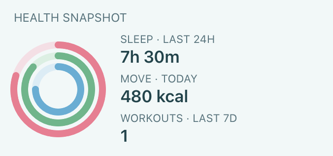
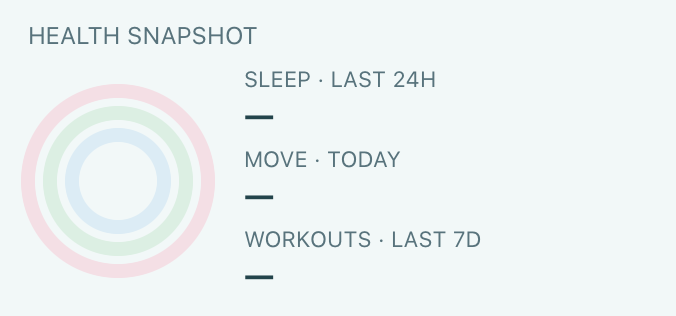

# Health readings

`$health` exposes read-only HealthKit access through the iOS/iPadOS adapter when `HKHealthStore.isHealthDataAvailable()` is true. macOS is not a supported native data platform for this contract. Package 2.0 must declare `health`; native uninstalled previews and future timeline projections cannot read it. Query cancellation, execution identity and data-query budgets apply. Request authorization through the main app; widgets cannot present the system consent sheet.

`authorizationStatus()` reports `notDisclosed` when HealthKit is available and the package can use it. It does not return a per-type read grant. Apple deliberately does not disclose read denial: [authorizing access to health data](https://developer.apple.com/documentation/healthkit/authorizing-access-to-health-data). Consent-sheet completion is not evidence that all read types were granted.

`stepCountToday()` and `activeEnergyToday()` query cumulative statistics from local start of day to the query time, in count and kcal. `heartRateLatest()` returns the latest available sample in bpm, with sample start/end. All return Promises; unavailable, query and policy errors reject.

API 1.3 adds `hasSamples` to these reading objects. Existing `value`, `unit`, `start` and `end` fields remain compatible. A false flag means no readable quantity/sample was returned; it cannot distinguish denied access from an empty store. The legacy numeric zero remains for compatibility. A true flag permits an actual zero daily aggregate to be displayed. The latest-heart query returns false and empty dates when there is no sample.

The Health Steps Ring template offers steps, active energy and latest heart rate, saved goals and explicit empty/error/platform states across eight sizes. Its record backup includes settings only. Readings are queried afresh rather than retained in package storage. The system can retain its previous rendered widget until the next permitted refresh.

Studio defaults provide current-day, explicitly simulated readings. Editing values, timestamps, units and `hasSamples` allows testing no-data, stale or malformed results. HealthKit returns real values only on an installed, authorized, supported device; browser/native fixture screenshots do not prove device authorization or sampling coverage.

## API 1.4 summaries

These reads require an installed Package 2.0 manifest with `health`. They reject in future timeline projections and Live Activity presentations, including the older basic reads and authorization request. They share the execution-wide eight-query budget with other system data APIs. Availability and the current installation identity are checked again before delivering results. No Health readings are cached, saved in package storage, exported or logged by these APIs.

- `await $health.sleepSummary({start?, end?})`: ISO 8601 bounds, default last 24 elapsed hours, at most seven elapsed days; no future end. Queries at most 256 recent sleep segments and exposes `truncated` when more exist. Returns `start`, `end`, `timeZone`, `hasSamples`, `sourceCount`, `truncated`, `totalSleepSeconds`, `inBedSeconds`, `awakeSeconds`, `conflictSeconds`, and `stages: {unspecified, core, deep, rem}` in seconds. Intervals are clipped to the query. In-bed is an independent union; duplicate same-stage intervals count once. Conflicting stages use **awake > REM > deep > core > unspecified**, identified by `aggregation: "union-awake-rem-deep-core-unspecified"`. This is ScriptWidget's deterministic aggregation, not Apple Health's source-priority calculation. `conflictSeconds` marks competing stages, which can come from the same source. Raw samples and source identifiers are never returned.
- `await $health.activitySummary({date?})`: Gregorian local `YYYY-MM-DD`, default today; no future day. Uses device time zone and calendar day boundaries, including 23/25-hour DST days. Returns `date`, `timeZone`, `hasSamples`, `moveMode` and three `{value, goal, unit}` rings. Move is `activeEnergy` in `kcal` or `moveTime` in `min`; exercise is `min`; stand is completed hours in `count`. Goals can be `null`; never infer a target from missing data. Known zero with `hasSamples: true` is valid.
- `await $health.workouts({start?, end?, limit?})`: default last seven elapsed days, at most 31 days, integer limit 1–50 (default 5). Returns `start`, `end`, `timeZone`, `hasSamples`, `truncated`, and newest-first `items`. Only wholly contained workouts are included. Each item has `id`, `activity`, `start`, `end`, `duration` (seconds), `energyKcal` and `distanceMeters` (nullable). Distance is available for supported walking/running/hiking, cycling and swimming activities. No routes, locations or arbitrary metadata are exposed.

Unknown options, malformed dates and invalid ranges reject with `invalid_options`. Unsupported hardware rejects with `unavailable`; SDK failures are sanitized as `query_failed`. An empty successful result cannot distinguish no records from records the user did not share. Empty activity summaries have zero values and null goals; empty workout lists and sleep stages do not manufacture readings. Review Health access explicitly in app Settings after adding new types; the template never requests consent automatically.

The **Health Overview** template supports `overview`, `sleep`, `activity` and `workouts` parameters across eight families. It displays real activity goals, sleep stages and a recent workout while retaining explicit setup, empty and error states. The package requests only `health`, with no storage or network access.

Web Studio provides editable, explicitly simulated best-state summaries and a **No shared data** scenario. Sleep mocks describe the aggregate above rather than raw HealthKit samples. Keep stage totals, intervals, `hasSamples` and units consistent when editing; invalid aggregates fail visibly. Workout samples are filtered by the requested interval and limit. Browser samples never authorize native access or persist native Health records. Native fixture and browser screenshots verify rendering, not real device HealthKit consent or source aggregation.

Native medium-size rendering with deterministic test data (not personal Health records):

The same layout with no shared samples; missing measurements remain empty:

