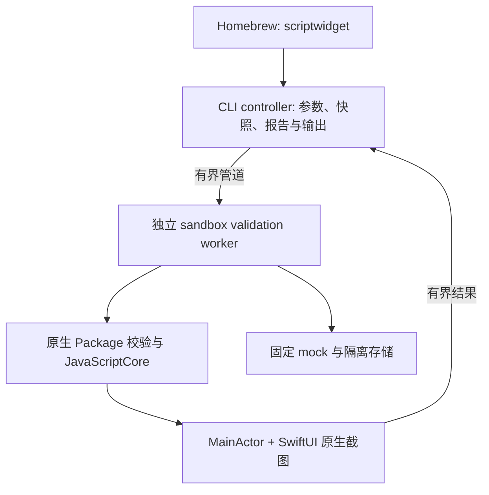

# Mac 原生校验 CLI：开发规格与 Homebrew 分发方案

日期：2026-10-23。状态：实现规格；CLI、Skill、Web 入口已经实现，正在完成发布验收。安装和当前限制以[用户文档](mac-cli.md)为准，本文保留设计决策与开发任务。已存在的 Node CLI / MCP 见[总体方案](agent-widget-validation-plan.md)。

## 1. 已确定的产品决策

| 项目 | 决策 |
| --- | --- |
| 核心目标 | 用户沿用自己的 Coding Agent，我们提供官方 Skill、机器可读的校验结果和可见的原生预览 |
| CLI 分发 | 自有 Homebrew tap + GitHub Releases；首先不申请 homebrew/core 收录 |
| Mac App 分发 | 继续 Mac App Store；不通过 brew 安装/更新 App，也不修改其已送审版本 |
| CLI 与 App 关系 | CLI 独立可用，无须安装、启动或登录 App；复用源码和契约，不调用 App 私有可执行文件 |
| 运行方式 | 本地原生 JavaScriptCore 执行 + SwiftUI 截图；不需要 Node、Chrome、模型或推理服务器 |
| 首版平台 | macOS 26 及以上，与当前 Mac 项目的 deployment target 一致；arm64、x86_64 分别构建和验收 |
| 范围 | 完整包静态检查、mock 执行、原生 PNG、包导出、环境诊断；不承诺实际 WidgetKit 系统展示或真实系统授权 |
| 网站 | 继续复用 Web Studio 浏览器内预览，明确近似结果；不将 Web 或 Mac App 桥接做为 CLI 的依赖 |

这里的“原生”指 macOS JavaScriptCore / SwiftUI，不等同于 iPhone WidgetKit。Mac CLI 没有 MLX 的 Apple Silicon 限制，因此 x86_64 也纳入构建验收；任一架构未通过时不得发布该架构或宣称支持。

推荐命名：可执行文件 `scriptwidget`，formula `scriptwidget-cli`，tap `everettjf/tap`（对应拟建仓库 `everettjf/homebrew-tap`），首版 `0.1.0`，Release tag `cli-v0.1.0`。这些是开发时采用的命名，不代表仓库或包已经存在。

## 2. 首版命令契约

首版必须有下列五项，不添加常驻服务、watch、自动安装到 App 或新 IDE 插件。

| 命令 | 执行内容 | 不执行的内容 |
| --- | --- | --- |
| `scriptwidget --version` | 打印 CLI 版本；`--format json` 另含 runtime/report 版本与构建 commit | 检查更新或联网 |
| `scriptwidget doctor --format json` | 系统/架构、内置资源、worker、签名可用性；探测图形会话并给出修复说明 | 自动申请权限、安装依赖、更改系统配置 |
| `scriptwidget check <package-dir> --format json` | 路径、manifest、入口与声明资源、JS/JSX 编译、可可靠识别的静态诊断 | 执行用户脚本；宣称所有动态 API 或分支正确 |
| `scriptwidget render <package-dir> --output <dir> --format json` | 完整预检后在隔离 worker 内 mock 执行，生成 Mac 原生 PNG 和报告 | 请求真实系统权限、连接账号、实际联网或写入用户组件 |
| `scriptwidget pack <package-dir> --output <file.swt> --format json` | 预检并按既有格式导出可导入的 `.swt` | 把包导入、安装到 App 或桌面；把编译通过当作运行验收 |

`check/render/pack` 首版只接收本地目录，避免同时实现多种输入。已有 `.swt` 仍可在 Web Studio / App 打开；CLI 直接接收归档、stdin 源码和远程 URL 后置。首版不新增 `init`、模板安装器或任意 shell 模板。无 widget.json 但有 main.jsx 的旧包，check/render 保留 legacy 读取并产生 warning；pack 要求有效 Package 2.0 manifest，缺少时明确失败，不自动转换。存在但损坏的 manifest 一律失败，不能按 legacy 重试。

`render` 参数冻结为：

- `--family small|medium|large`，默认 `medium`；必须符合包声明。Mac 首版仅承诺这三种尺寸，其他尺寸明确报 unsupported，不偷偷映射。
- `--appearance light|dark|both`，默认 `both`；每种外观从同一源快照和初始 mock 独立执行。
- `--fixtures <file.json>`，可选；不提供时使用随 CLI 版本固定的安全样例，报告列出默认值来源。
- `--param <string>`，可选，默认空；`--scale 1|2`，默认 2。画布逻辑尺寸复用 Mac 预览的尺寸定义：small 169×169、medium 360×169、large 360×376 pt；首版不接任意宽高或 WidgetKit 渲染模式切换，固定 fullColor。
- `--output <dir>` 必填，必须位于输入包外。输出为新建的 `run-<id>/report.json`、`light.png`、`dark.png` 中的适用文件，不覆盖旧运行。
- `--timeout <seconds>` 为整条命令上限，默认 60、范围 1–120；只能缩短或约束总时长，不能增加 runtime 内部 5 秒执行 / 10 秒编译预算。
- `--fail-on-warning` 可选；默认保留 warning 而不失败，开启后 warning 触发退出码 1。显式要求了原生 render 却没执行时绝不能成功。

`check/pack` 不接收无效的 render 参数；不使用 `--backend auto`，避免偷偷切换到 Web。所有命令提供 `--help`。人读格式为默认，Agent 使用 `--format json`；stdout 仅输出一个 JSON 对象，进度与工具日志写 stderr，脚本日志进入报告。默认不打开窗口，不抢焦点。

拟定首次使用流程：

```sh
brew install everettjf/tap/scriptwidget-cli
scriptwidget doctor --format json
scriptwidget check ./MyWidget --format json
scriptwidget render ./MyWidget --appearance both --output ./artifacts --format json
scriptwidget pack ./MyWidget --output ./artifacts/MyWidget.swt --format json
```

后续由用户打开 `.swt` 并使用现有 App 导入。不得通过 brew post-install 替用户操作 App、写入 iCloud 或创建组件。

## 3. 退出码与报告 v1

| 退出码 | 含义 |
| --- | --- |
| 0 | 本命令要求的检查均完成并通过；不表示真实系统能力都已验收 |
| 1 | 组件/fixtures 校验失败、脚本异常、执行超限，或开启 fail-on-warning 后出现警告 |
| 2 | CLI 用法或工具环境错误，例如输入不存在、输出目录不安全、资源缺失、系统不支持、图形会话不可用或 worker 启动失败 |
| 3 | worker 崩溃、内部协议错误或未预期工具故障 |
| 124 | 命令总体超过 deadline；内部单脚本资源超限仍为 1 |
| 130 | 用户取消；必须清理子进程，不能留下成功报告 |

可以确定是系统/用户错误时不报组件错误。可以确定是脚本错误时不以工具崩溃掩盖。所有启动后失败尽力返回相同 report v1，JSON 无法落盘时仍在 stdout 返回错误对象。CLI 参数解析也要尽可能遵守 JSON 模式。

报告最小字段：

| 字段 | 契约 |
| --- | --- |
| `reportVersion` / `command` / `status` | 分别为 `1`、命令名、`passed|failed|error|cancelled` |
| `tool` | CLI 版本、build commit、native runtime API 版本、compiler fingerprint、内置参考资料 hash |
| `backend` / `target` | `mac-native`，或静态阶段 `static`；平台、实际系统/架构、family、逻辑尺寸与 scale |
| `sourceHash` / `fixturesHash` / `requestHash` | 所检查内容、有效 mock、完整执行参数的 SHA-256；未取得输入时为 null |
| `checks` | `package`、`compile`、`execute`、`render`、`export` 各自 `passed|failed|notRun`，有原因；不同外观分别记录 |
| `diagnostics` | 稳定 code、severity、message、可选 package-relative file/line/column、相关文档链接；不能伪造位置 |
| `artifacts` | 相对报告目录的路径、字节数、SHA-256、对应外观与 source/request hash；失败阶段没有成功图片 |
| `execution` | 固定时钟/时区/locale、参数、mock 版本、所执行模块、日志与耗时；不输出真实敏感系统数据 |
| `limitations` | 显式列出 mocked、unsupported、notRun，提醒 SwiftUI 快照不等于桌面 WidgetKit/交互结果 |

`pack` 不执行脚本，execute/render 必须为 notRun。`check` 的通过表示静态检查通过，报告不许把 execute 标为 passed。未知标签/属性只有在元数据与原生 switch 对齐且可可靠判断时给诊断；动态属性或未执行分支不能承诺覆盖。

指纹的字节协议在开发前固定如下，摘要均为小写 SHA-256 hex：

- `sourceHash` 输入为 UTF-8 前缀 `ScriptWidgetSource/v1\n`、8 字节 big-endian 文件数，然后逐项编码路径与原始内容。文件按包内相对路径的 UTF-8 字节升序，每项为 `u64be(pathByteCount) + pathUTF8 + u64be(contentByteCount) + contentBytes`。不做 Unicode 或换行归一化，路径有效性由包校验先保证。
- 输入包括 manifest、源码和资源；排除 `__Build`、`.git` 及工具缓存，忽略目录项本身。禁止 symlink/hard link，隐藏的用户文件不能一概丢弃；pack 与 hash 使用同一份显式清单。绝对路径、mtime、run ID 不进入 sourceHash。
- `fixturesHash` 使用独立前缀 `ScriptWidgetFixtures/v1\n`，依次编码固定默认 fixture 文件的原始字节、用户 fixture 原始字节（无文件时为空）、fixture 格式版本；每段都使用上述 u64 长度前缀。相同 JSON 的空白变化可以产生不同 hash，首版不引入 JSON canonicalization 库。合并规则固定为默认值加用户按同一 Web fixture 规则覆盖，并记录被覆盖的方法。
- `requestHash` 使用前缀 `ScriptWidgetRequest/v1\n`，按固定顺序编码 command、sourceHash、fixturesHash、CLI version、build commit、runtime API version、compiler fingerprint、target platform、实际 OS build、architecture、family、appearance、renderingMode、scale、parameter、固定时钟、timeZone、locale、random seed。字段统一为 UTF-8 字符串，每段加 u64 长度；不适用字段用空字符串，双外观分别计算 requestHash。

D1 必须提供 Swift 与 Node 可复算的黄金样例。不能依赖字典枚举、本地排序或 JS 浮点数隐式转换生成指纹，也不能拿同 hash 当作像素必然一致的保证。

每次 render 先创建独立运行目录，报告与图片采用原子写入。成功报告仅引用本次且 hash 匹配的文件；失败报告不引用旧图片。旧运行留在原目录供用户查看，不以旧截图当作最新成功。默认不保存源码副本，不把包内容写入日志。JSON 响应只返回必要摘要与报告路径；详细日志设总量限制并标记截断。

## 4. 架构：独立 CLI 与受限的原生 worker



controller 不执行用户 JS。native worker 采用单独签名、启用 App Sandbox 的无界面 bundle，无网络、共享容器、iCloud、Keychain 共享和系统个人数据权限；不可简单复制 App entitlements。父进程与 worker 用有界 stdin/stdout 消息传输快照与结果，不开启 HTTP 端口、常驻 daemon 或 MCP 服务。父进程使用 Process 与参数数组，不拼接 shell。

worker 独立建临时目录，收到的包文件再次验证后落盘；API 只见这份快照。父进程保留输出权限，worker 通过管道返回有界 PNG 字节，由父进程写入指定目录。pipe 的创建/继承、App Sandbox 下的启动方式与可用文件描述符在任务 D0 验证，不假设子进程天然继承任何安全边界。[Apple App Sandbox](https://developer.apple.com/documentation/security/app-sandbox)。

这不是针对未知 JavaScriptCore 漏洞的绝对安全证明。必须同时有系统 sandbox、宿主 API 权限/路径约束、禁用真实服务和进程级 deadline。不能退化成以用户完整权限执行脚本，或以废弃 sandbox-exec 脚本替代可分发实现。

MainActor 驱动渲染和 run loop；执行上下文、超时和取消不能阻塞同一主线程，阻止 watchdog 失效。父进程负责最终强制终止和回收 worker；进程退出是默认清理路径，不能只依赖 Swift Task cancellation。先顺序执行，浅深色可使用独立 worker，不做并发优化。

SwiftUI 快照是否在无登录图形会话中可用，需要独立验证。首版 render 的支持范围为有正常图形会话的 Mac，包括不抢焦点的后台进程；纯 SSH/无 WindowServer 场景不承诺。doctor 必须说明原因；check/pack 不依赖截图，若渲染环境不可用不能把它们也误报为组件失败。

## 5. 源码复用与具体改动位置

建议新增 `Tools/ScriptWidgetCLI/`，包含自己的 Xcode project、controller/worker 入口、资源清单、原生 CLI 测试；不先迁移整个 Shared 到 Swift Package，也不链接整套 Mac App 启动逻辑。新增目标通过显式引用编译需要的现有源文件，清单要覆盖其传递依赖，禁止复制一套 runtime 分叉。

| 已有源文件/区域 | 复用方式与必要调整 |
| --- | --- |
| [ScriptMetadata.swift](../Shared/ScriptWidgetRuntime/Common/ScriptMetadata.swift) | 复用 WidgetPackageManifest 及原生校验；Package 2.0 的 unknown keys/版本仍 fail closed |
| [ScriptWidgetPackage.swift](../Shared/ScriptWidgetRuntime/Common/ScriptWidgetPackage.swift) | 复用 canonical 文件访问、快照与预算；CLI 使用显式临时根，不建立用户 library managed scope |
| [ScriptManager.swift](../Shared/ScriptWidgetRuntime/Common/ScriptManager.swift) | 抽出需要的 archive policy / bundle resource 读取入口；CLI 不初始化 sharedScriptManager、iCloud 或用户组件清单 |
| [原生 runtime](../Shared/ScriptWidgetRuntime/Widget/Runtime/ScriptWidgetRuntime.swift)与[RunningState](../Shared/ScriptWidgetRuntime/Widget/Runtime/ScriptWidgetRunningState.swift) | 复用编译、JSX 解析与执行限制；新增显式可注入的 validation host policy，默认 App/扩展行为保持原契约 |
| [ScriptWidgetElementView.swift](../Shared/ScriptWidgetRuntime/Widget/Component/ScriptWidgetElementView.swift) | 复用 SwiftUI 映射，结合 ImageRenderer 或 NSHostingView 的已有截图方式；不创建第二套绘制器 |
| [Mac 预览尺寸](../macOS/ScriptWidgetMac/Editor/Preview/PreviewWidgetSize.swift) | 将确需复用的尺寸定义抽为无 App 启动依赖的单一来源，不能复制后各自维护 |
| `support.bundle` 与 `Resource/*.schema.json` | 作为 CLI/worker 的显式资源打包；使用自己 bundle 的 resolver，不依赖另一个 App 的 Bundle.main |
| [API 元数据](../Editor/editorfe/src/scriptWidgetAPI.js)与 API 文档 | 为 Skill 提供可追溯快照；原生 switch 是运行时权威，completion metadata 不变成可执行授权清单 |

现在有只读 previewStorage，但并不代表所有系统 API、fetch manager 和容器访问都已隔离；部分测试 provider 也只在 DEBUG 下可注入。开发时必须增加正式 validation host 接口，不把测试环境变量或 DEBUG 开关当成发布版功能。

归档导出复用仓库已有 ZipArchive 依赖与锁定版本，直接操作已验证的临时快照；不调用会 ensureManifest 并改写源包、或依赖用户 library 的 ScriptManager 导出入口。抽出纯校验/导出函数而不是复制其实现；包含该依赖的许可。首版不新增参数解析、网络、MCP 或模型 SDK。

若共享 Swift 源改变，必须覆盖所有引用的 App/extension/test target，按仓库要求 lint 两个平台 pbxproj 并运行完整 release-readiness。CLI 自己有新 project 时也 lint 它。iOS、Mac App 与 widget 不能因为 CLI 的依赖拆分而编译失败或获得新权限。

## 6. Mock 与受限执行契约

首版直接沿用 Web 的用户 fixture 格式（`api`、`fetch`、`storage`、`dataSource` 等），增加版本说明而不发明一套不兼容字段。有效默认值、错误形态和异步行为对齐现有[Mock Data 文档](web-studio-browser.md#mock-data)。CLI 额外的时钟/locale 等执行环境作为报告和 host 配置，不擅自加入用户 fixture 的顶层字段。对于 native 暂时无法实现的 fixture，不忽略：明确报 `fixture.unsupported`，该场景不可标为通过。

必须先按正常包权限/域名/插件契约判断，再查 mock。模拟成功不能绕过 networkDomains；manifest 不合法不能因为 fixtures 有值就继续。动态导入仍然只在快照内，通过 native 路径校验。

需要列明的 host 行为：

- `$file` 只访问快照，写操作只到本次可丢弃的临时视图；用户源包永不修改。`$storage` 使用独立内存或临时后端，允许场景内读写，不落用户真实记录。
- fetch/$http、数据源插件与远程图片只读显式 fixture/包内资源，无 fixture 时可复现地失败，不能实际联网。图片渲染器也受此约束，不能只拦 JS fetch。
- Health、Location、Calendar、Reminders、Photos、Music、服务账号和系统/设备读数仅走 validation host。禁止请求真实授权、读取钥匙串/用户名等个人信息或产生系统写入。
- 与平台不符的系统能力默认显示 unavailable。若显式 mock 模拟了它，报告标为 synthetic/mock，不据此声称该 API 已在 macOS 真正可用。
- 时间固定为 `2026-01-01T12:00:00Z`、随机种子 42、时区 UTC、locale en_US；随机序列沿用现有 parity prelude 的算法并有黄金样例，默认示例数据同版本固定。用户 fixtures 仅覆盖文档支持的 API 值；结果记录有效值，浅深色从相同初始状态开始。不能用“再次渲染颜色”替代分别执行。

所有公开 host API 必须在能力清单中有 `mocked|unavailable|rejected` 分类，默认拒绝未知路径。不允许因为某个 provider 注入未完成就落回 sharedFetchManager 或真实系统服务。这份清单与 API 元数据做差异测试；CLI 限制不改变 App 的正式 API 可用范围。

资源预算复用现有常量：源码 512KiB、转译后 2MiB、执行 5 秒、编译 10 秒、元素 1000/深度 64 等。目录快照沿用当前 500 entries、单文件 25MiB、总量 64MiB、深度 16；pack 沿用 archive policy（当前归档 32MiB、展开 64MiB），不能扩大限制。原生图片/网络预算也继续生效。

新增 CLI 传输预算固定为：请求按 64MiB 原始文件上限加协议元数据分段传输；单张 PNG 10MiB，报告/诊断合计 2MiB，其中日志最多 256KiB，响应总量最多 24MiB。不要将整个包一次 base64 后无限缓冲；超限返回明确资源错误。父进程单 job 同时只保留必要快照/图片，不长期缓存 Babel 或用户包。worker 的实际内存上限机制和 RSS 监测能力在 D0 验证，不能将采样式终止宣传成严格内核内存隔离。

输入与输出都做 canonical 边界检查，拒绝 symlink、hard link、路径穿越、大小写冲突和读取中被替换的文件；复用已具备的 descriptor-based 读取，校验通过后执行同一快照。输出也拒绝通过 symlink/替换父目录逃逸；pack 目标存在即失败，首版不提供隐式覆盖。

## 7. Homebrew 包结构与签名发布

首版采用自有 tap 的 formula 下载我们预编译的架构专用 release archive，安装到 libexec，并在 bin 放薄 shell 入口。用户无需 Xcode、开发证书、Node 或 Chrome；Homebrew 自身环境要求按其官方说明处理。它是 CLI formula，不是给 App 做 cask。

建议每个架构 archive 包含：

```text
ScriptWidgetCLI.app/
  Contents/MacOS/scriptwidget
  Contents/Helpers/ScriptWidgetValidationWorker.app/
  Contents/Resources/agent-skill/SKILL.md
  Contents/Resources/agent-skill/references/...
  Contents/Resources/report-v1.schema.json
  Contents/Resources/licenses/...
```

worker 自有 Resources 打包 support.bundle、schema 与固定 mock。 `.app` 在这里用于资源定位、签名和 stapling，是无 GUI 的内部包装，不是第二个用户应用；brew 不把它装入 /Applications，也不注册为组件安装入口。CLI 的 doctor 输出实际 Skill 目录供用户按其 Agent 的方式安装，不从 brew 脚本修改用户 Agent 配置。

分发步骤冻结为：

1. 在受控 macOS builder 对同一 commit 构建两个架构并执行测试；产物版本、runtime/API、文档快照和 report schema 完整对应。
2. 使用 **Developer ID Application** 签名内部 worker 与外层 bundle，启用 Hardened Runtime；按内到外顺序显式签，不用 `codesign --deep` 掩盖缺签。仅在实际 JavaScriptCore 要求且验证必要时加入最小 JIT entitlement，不加调试、禁用库校验等宽泛权限。
3. 用 `notarytool` 提交并确认 Accepted，检查日志，给可支持的 `.app` staple，再生成最终架构 archive 和 SHA-256。不能把 Mac App Store 的 Mac Distribution 证书拿来替代，也不能声称给裸二进制/ZIP 直接 staple。[Apple 公证要求](https://developer.apple.com/documentation/security/notarizing-macos-software-before-distribution)、[定制公证流程](https://developer.apple.com/documentation/security/customizing-the-notarization-workflow)。
4. 发布 `cli-v<version>` 的 GitHub Release，上传最终 archive、校验和、构建/测试/公证摘要及许可；既有版本 URL 与字节保持不可变。
5. 在 tap formula 中固定对应架构 URL、SHA-256、macOS 26 下限，将 bundle 原样放入 libexec；bin wrapper 仅 exec 对应绝对路径并转发参数，不改动签名内容、不 ad-hoc 重签、不要求 sudo。
6. 用干净用户环境跑 brew install/test/upgrade/uninstall，验证实际安装后的签名、公证票据和断网运行。安装通过后再更新官网/Skill 的安装命令。

Homebrew tap 的命名与全限定安装方式见[官方 Taps 文档](https://docs.brew.sh/Taps)。官方 bottle 是另一套明确的构建/元数据流程，首版不把“下载上游预编译 archive”称为 Homebrew 官方 bottle；之后若采用 bottle，必须验证 relocation 不修改签名 bundle，并按[Bottles 文档](https://docs.brew.sh/Bottles)维护平台 checksum。

formula 的测试要实际创建合法与非法最小包并运行 check，不能只测 --version；带图形会话的 release 验收另外运行 render。升级/卸载只管理 CLI 安装文件，不删除用户源包、报告或 App 数据。CLI 不内置自更新器；使用 brew upgrade。

Developer ID 与公证凭据仅供 release workflow 使用；PR 测试不接触签名密钥，不执行来自不可信 fork 的发布脚本。没有可用 Developer ID 时可继续 unsigned 本地开发，正式发布 gate 保持未通过，不能关闭 Gatekeeper 绕过。

## 8. Skill、MCP 与 Web 如何交付

官方外部 Skill 随 CLI 同版本分发，也放在仓库可审核目录中。内容为精简 SKILL.md 与按需 reference，不包含模型、凭证或本机绝对路径；说明 `check → render → 阅读诊断与图 → 修复 → pack`，并解释退出码、mock 与原生/WidgetKit 区别。输出目录放包外，避免自污染输入。

Skill 的命令只能引用已经发布的功能。最低 CLI/report/runtime 版本写入参考资料；工具版本不匹配时先报告具体差异，不能盲目重试。保持与 App 内 `.swskill` 的两文件契约分开，不赋予 App 内 Skill 执行能力。

首版不新增 native MCP 实现。已有 Node MCP 暂保留为现有 Web 预览工具，不能把其截图标成 Mac 原生；Agent 有 shell 能力即可使用新 CLI。后续 MCP 可薄封装同一 CLI/report 契约，但不阻塞本次交付，也不让 CLI 依赖 Node。

Web 最小增量限于“校验并预览”入口、报告导出和清晰的覆盖标记，继续客户端沙箱执行。可以复用 report v1 中的公共字段，但 backend 必须标为 web，native-only 检查为 notRun。网页不调用 brew CLI、不读取 Mac 本地端口、不要求安装 App。D5b 复用 report v1 的指纹协议与黄金样例；现有 Web 引擎 hash 算法不同，旧报告需明确标记算法版本，不能直接拿旧 hash 与新 CLI 比较。只有相同源码清单、mock 及指纹算法的报告才适合关联，版号与渲染差异须可见。

## 9. 开发任务、依赖与验收

任务按下表进入开发，D0 是第一项实现工作，无需先向用户重新讨论产品范围；出现架构阻碍时报告具体事实，不静默降级隔离或改成 App 依赖。

| ID | 工作与主要落点 | 依赖 | 可验收结果 |
| --- | --- | --- | --- |
| D0 | `Tools/ScriptWidgetCLI` 最小 controller/签名 sandbox worker；载入 support.bundle；执行一个 JSX 并输出 PNG | 无 | 不安装 App、无 Node/Chrome；管道通信、图形会话、进程终止、资源定位可用；sandbox 拒绝外部文件与出站连接；形成可留存探针报告 |
| D1 | 冻结 report v1 schema、诊断 code、hash/framing 黄金样例、五个命令解析和退出码 | D0 | 同输入跨运行 hash 一致；参数/fixtures 改变 requestHash；JSON stdout 不混日志；所有失败码有用例 |
| D2 | 完整包快照、原生 manifest/compile、pack 与依赖源文件清单 | D1 | 合法包通过；坏 manifest、缺入口、symlink/hardlink、替换/逃逸、过大文件被拒；输出不改源包 |
| D3 | 正式 validation host、固定 mock、隔离存储与 API 能力清单 | D2 | 成功/空值/拒绝/异常场景可复现；缺 mock 不走真实系统/网络；manifest 权限不能被 fixture 绕过 |
| D4 | Mac 原生 render、浅深色、截图和有界诊断/日志、取消与 deadline | D3 | 源码/fixture/报告/PNG 对应；死循环、超时、崩溃退出可区分；无旧图冒充结果，worker 不残留 |
| D5a | Skill 与仓库外使用文档 | D1、D4 | 真实 Coding Agent 完成正常生成及错误修复闭环，工具版本和报告对应 |
| D5b | Web 简明校验入口/报告标记 | D1 | 用户可在 Web 打开包看效果和复制报告；只标记实际执行的 backend，不阻塞 CLI 发布 |
| D6 | GitHub Release 构建、公证、tap formula、双架构安装/升级验收 | D4、D5a | 全新环境 brew 安装后离线 check/render/pack 可用；签名不被安装破坏；App 数据无变化 |

D0 未过之前不开始大规模 host 重构或分发自动化。各任务使用确定性 fixtures，先 focused tests，再在涉及 shared runtime 时执行 `./Scripts/release-readiness.sh`；两端 project 与 App/extension 构建按仓库 gate 完成，不以 CLI 单测代替。

发布必测矩阵：

- macOS 26 arm64/x86_64 的构建与相应硬件/runner 执行；不能只用交叉编译声称运行覆盖。新 macOS 版本需独立验证后增加。
- 小/中/大、浅/深色；纯文本、图表、包内图片、热力图与 mock 数据异常；图形会话有/无的清楚结果。
- 带/不带 App、已有 App 组件与账号数据的环境；CLI 不读写其 iCloud/app group/Keychain，也不产生授权弹窗。
- 包路径空格/中文、TOCTOU、文件/归档预算、坏 fixture、资源缺失、JS 异常、未 render、死循环、取消、worker 崩溃和多次运行后资源回收。
- 安装后断网运行；brew upgrade/uninstall；旧 Skill/新版 CLI 与旧 report reader 的明确兼容错误；签名和公证证据保存。
- Web 近似图与 Mac 原生图的标记不混淆；真实 Agent 的自动修复与用户看图步骤有记录，不假称真机或 WidgetKit 验收。

发布前材料为：实现、安装文档、Skill、report schema、跨语言 hash 样例、固定输入/报告/截图、平台测试清单、release 校验和与公证记录。首版不交付模型、在线执行服务、真实账号自动化或 Mac App 的新发布。

## 10. 本次规格核对依据

本仓库研究分支核对确认：Mac project 当前各相关配置的 deployment target 为 26.0；runtime 的 compiler 通过 ScriptManager 读取 support.bundle，RunningState/多个 API 仍可能引用共享容器/服务；Mac App 有模板批量预览入口，但不是对外 CLI；原生测试已有 NSHostingView/ImageRenderer 截图路径。这些支持代码复用，同时解释了为何必须先完成 D0 与 host 隔离。

实现进度与发布验收以用户文档和对应 release 记录为准。D0 已验证独立 native 执行/PNG 及 App Sandbox 外部文件读写拒绝；现有 App 无需更新。

## 首版实现边界补充

Native 0.1 以明确的 api/fetch/storage fixtures 支持常见离线预览；未实现的数据源插件与其他 fixture 段明确失败。系统查询的完整原生参数语义尚未覆盖，带参数的 mock API 调用产生警告，不作为真实查询成功的证明。worker 采用 768 MiB RSS 采样终止预算，它不是严格的内核内存隔离。版本/环境错误的报告采用最小 schema，只有取得源输入后才提供内容指纹；render 成功与组件失败报告落盘，启动/总体 deadline 故障始终在 stdout 返回结构化错误。
