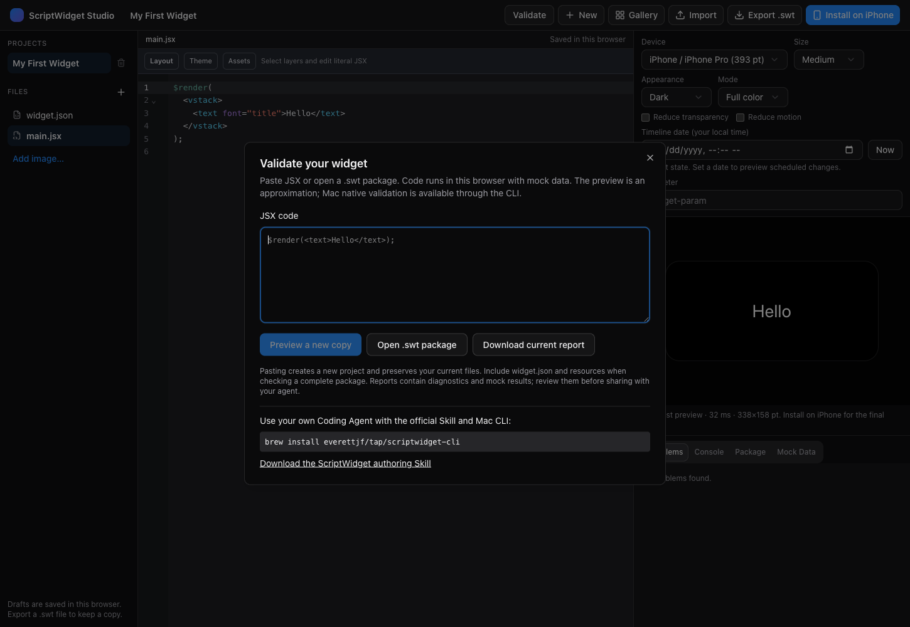

# ScriptWidget Mac CLI

Use your own Coding Agent to create ScriptWidget packages, check them locally, and inspect native SwiftUI previews. The CLI is independent of the Mac App Store application: no App installation, login, Node, Chrome, model download or inference server is required.

## Install

```sh
brew install everettjf/tap/scriptwidget-cli
scriptwidget doctor --format json
```

The CLI requires macOS 26 or later. Releases contain separate arm64 and x86_64 packages, signed with Developer ID and notarized by Apple. Native rendering needs a logged-in graphical session. The App continues to be installed and updated through the Mac App Store.

Download the [authoring Skill](https://github.com/everettjf/scriptwidget/releases/download/cli-v0.1.1/scriptwidget-author-0.1.1.zip), unzip it, and install the `scriptwidget-author` folder using your agent's Skill installation instructions. A matching copy ships with the CLI; `doctor` reports its local path. This is an external Coding Agent Skill, not the App's `.swskill` format. Do not automatically grant tools or system permissions because a Skill suggests them.

For copy-to-folder Claude Code installation, browser preview and iPhone import, see the [Agent quick start](agent-quickstart.md).

## Check, preview and export

```sh
scriptwidget check ./MyWidget --format json
scriptwidget render ./MyWidget --family medium --appearance both --output ./artifacts --format json
scriptwidget pack ./MyWidget --output ./artifacts/MyWidget.swt --format json
```

Start from [Package 2.0](package-format.md). `check` validates the manifest and compiles package JS/JSX without executing user scripts. `render` performs those checks, executes with offline mock data, and writes a fresh run directory containing light/dark PNGs and `report.json`. `pack` exports a `.swt` from the validated snapshot without executing scripts. Open the archive with the existing ScriptWidget App to import it.

All output must be outside the package. Archives are never overwritten. Preview families are small, medium and large; appearance is light, dark or both. Use `--fixtures file.json` for supported mock overrides, `--param text`, `--scale 1|2`, and `--fail-on-warning` when warnings should fail the check. `--timeout` bounds the whole command without increasing the runtime's own budgets. `--help` lists the options.

A legacy `main.jsx` package can be checked/rendered with a warning; packing requires `widget.json`. A present malformed manifest always fails. Call `$render` in the entry source rather than hiding its only occurrence in an import, because the current runtime detects rendering from entry source.

## Results and limits

JSON stdout is one report; stages distinguish package, compile, execute, render and export. `notRun` means not checked. Each preview records source/mock/request fingerprints, diagnostics and its artifacts. Failed runs do not point at previous images. Exit codes: 0 requested checks passed; 1 widget/fixture failure; 2 usage/environment failure; 3 internal worker failure; 124 total timeout; 130 cancellation.

The native worker runs under App Sandbox with no network, app-group, iCloud or shared Keychain access. It reads an isolated package snapshot, uses temporary storage, and cannot change your App library. Time and random defaults are fixed. A sampled 768 MiB worker memory guard and an independent deadline stop runaway jobs; these are CLI budgets, not a measurement of WidgetKit extension memory.

System-data replies are synthetic. Native CLI 0.1 supports `api`, `fetch` and string-valued `storage` fixtures; unsupported sections fail explicitly. The included Skill documents examples. HTTP fixtures match URL and method; they do not certify real server behavior. API calls with query arguments warn that mock responses do not validate all real-system query semantics. Remote images need a matching fetch fixture containing a data-image URL; otherwise the image is a marked placeholder. Data Source Plugin execution is not supported in native CLI 0.1; Web Studio offers its own plugin mocks.

A native PNG proves that the selected mock scenario produced a macOS SwiftUI snapshot. It does not prove real authorization, account access, iPhone behavior, interaction, WidgetKit refresh scheduling or visual acceptability. Review the images and test real data separately. Missing package images and unavailable custom fonts produce warnings; bundled App fonts are not installed into your system by the CLI.

## Browser validation

Open [Web Studio](https://xnu.app/scriptwidget/studio/) and choose **Validate**. Paste JSX to create a new copy or import a `.swt`, inspect the browser preview, then download the current report for your agent. Reports reject stale preview results after code, mocks or settings change. Browser checks run locally, identify backend `web`, and mark native verification `notRun`; they remain an approximation of system fonts, symbols, charts and rendering.



## Development and releases

The source and Xcode project are in [Tools/ScriptWidgetCLI](../Tools/ScriptWidgetCLI). `node Tools/ScriptWidgetCLI/prepare-resources.mjs` regenerates the versioned catalog and Skill references; XcodeGen regenerates explicit project references. Build `ScriptWidgetCLI`, then run `python3 Tools/ScriptWidgetCLI/Tests/smoke.py <absolute-path-to-scriptwidget>`.

`Tools/ScriptWidgetCLI/release.py --output <new-directory> --notarize` builds both architectures, tests their exact binaries, signs bundles, notarizes through the `ScriptWidgetCLI` Keychain profile, staples tickets and verifies extracted archives. It requires a clean commit and never reads credentials from source files. Setup of that local credential profile is separate from the repository; no password is committed. Release assets and the tap formula contain immutable versioned URLs and SHA-256 checksums. Upgrade with `brew upgrade scriptwidget-cli`.
