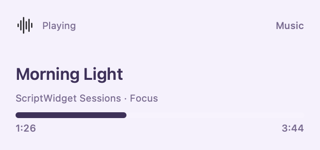
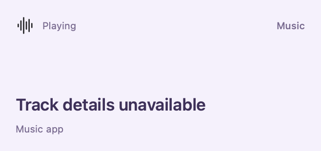
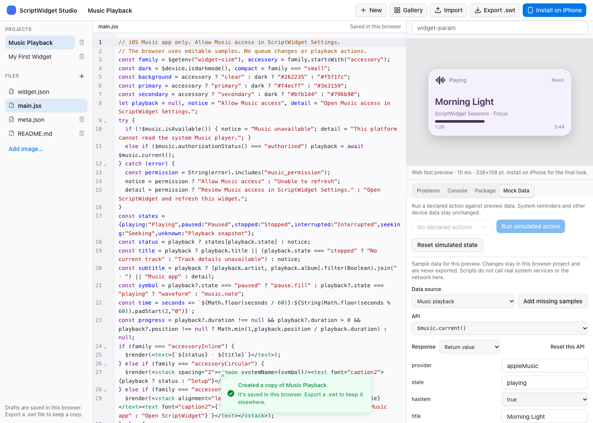

# Music app playback

Runtime API 1.4 adds the read-only `$music` namespace. An installed Package 2.0 widget must declare `"permissions": ["music"]`. Music library authorization is requested by a person in ScriptWidget Settings, never by imported JavaScript. No network permission is needed.

```jsx
if (!$music.isAvailable()) {
  $render(<text>Music playback unavailable</text>);
} else if ($music.authorizationStatus() !== "authorized") {
  $render(<text>Allow Music access in ScriptWidget Settings</text>);
} else {
  const playback = await $music.current();
  $render(<text>{playback.title || `${playback.state}: track details unavailable`}</text>);
}
```

`isAvailable()` is synchronous and checks the installed execution, declared permission and platform adapter. It does not mean access is authorized. `authorizationStatus()` is synchronous: `authorized`, `denied`, `restricted`, `notDetermined`, `unavailable`, or `undeclared` when package access is missing. `current()` returns a Promise with exactly these fields:

| Field | Value |
| --- | --- |
| `provider` | `appleMusic` |
| `state` | `playing`, `paused`, `stopped`, `interrupted`, `seeking`, `unknown` |
| `hasItem` | Whether the system exposes a current media item |
| `title`, `artist`, `album` | String or null; at most 512 UTF-8 bytes, no control characters |
| `duration` | Seconds, positive and at most 604800, or null |
| `position` | Seconds, zero through 604800, or null |
| `capturedAt` | ISO 8601 UTC capture timestamp |

Missing item details never imply stopped playback. When `hasItem` is false, title, artist, album and duration are null; position may still be present. Unknown duration is null, rather than zero. The timestamp identifies a snapshot, not continuous playback telemetry. Neither missing metadata nor successful reading proves an Apple Music subscription.

Each execution shares one in-memory snapshot and the existing eight-query system-data budget. Scripts receive independent objects. Nothing is persisted or logged. Permission, installed identity and execution lifetime are checked before reading and again before delivery. Future timeline entries and Live Activity presentations cannot query the player; prepare display data in the current entry instead.

Apple requires the [music player](https://developer.apple.com/documentation/mediaplayer/mpmusicplayercontroller) to be accessed on the main thread. Synchronous widget hosts capture the installed identity and snapshot before waiting for JavaScript on another queue. Asynchronous background previews dispatch the read to the main queue. This avoids queuing a read behind a main-thread synchronous wait.

The public [systemMusicPlayer](https://developer.apple.com/documentation/mediaplayer/mpmusicplayercontroller/systemmusicplayer) shares state with the iOS Music app. It does not expose arbitrary apps' audio. Home Sharing can withhold the current item. The system-player API is unavailable on macOS; ScriptWidget returns an explicit unavailable state there. This increment does not scan the library, request artwork, subscribe to playback notifications, authenticate a service, start playback or change a queue.

Web Studio uses editable samples under Mock Data → Music playback. Playing, paused, stopped, track details withheld, permission denied and unavailable presets are provided. Package permission, snapshot schema, timeline restrictions and query limits still apply. Mock data stays in the browser draft and is excluded from package exports.

Native JavaScriptCore fixture capture (sample data, not a real account):



Playing with metadata withheld:



Editable Web Studio sample:



The [Music Playback template](../Shared/ScriptWidgetRuntime/Resource/Script.bundle/template/Music%20Playback/README.md) handles all eight widget families. Automated tests execute actual native JavaScriptCore with an injected provider and compare 48 native/Web trees. SDK compilation and fixture tests do not establish signed-device Music authorization or widget-extension behavior; those remain acceptance work. Playback controls and subscription extensions are outside the current A/B delivery scope.
