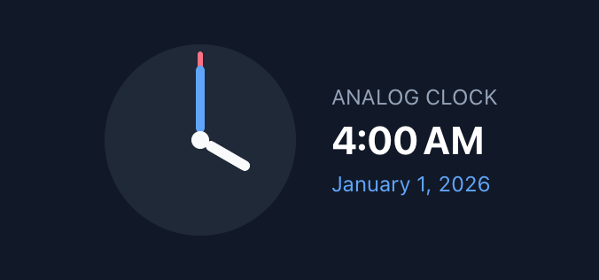
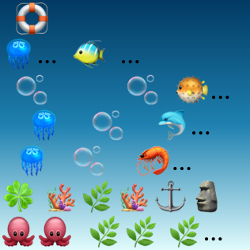
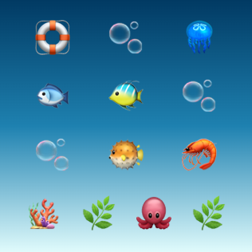
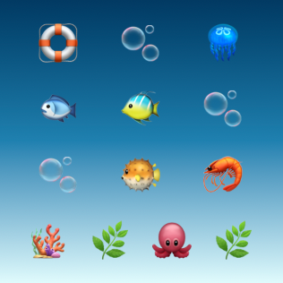
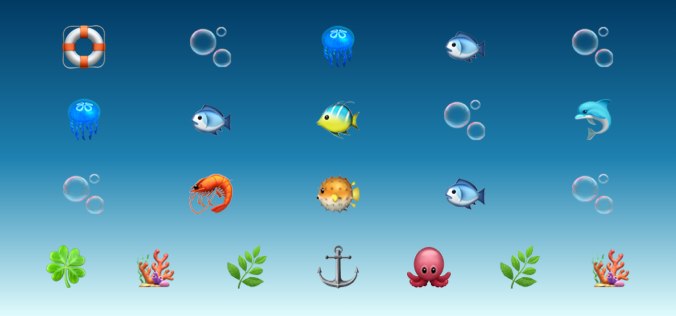
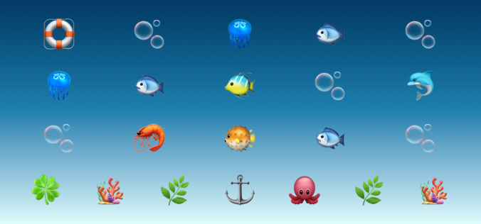

# Public clock, swing and GIF scheduling

Runtime 1.4's release candidate uses Foundation parsing (without the former SwiftyJSON dependency in this modifier), public SwiftUI `TimelineView`, `rotationEffect`, `offset` and ImageIO. It no longer resolves or decodes a private WidgetKit clock-hand modifier. No timer reruns JavaScript or re-queries personal data on animation ticks.

| Context | Behavior |
| --- | --- |
| Active iOS app preview | Public scheduled clock/swing poses and bounded GIF frame selection, requested at no more than 30 updates per second |
| Widget / Live Activity | The OS controls scheduling and may hold a snapshot; a live app/browser preview does not prove continuous system animation |
| Inactive scene or fixed scheduled entry | Clock pose at the fixed date, swing at rest, GIF first frame; no app-owned background animation loop |
| Reduce Motion / reduced luminance | Standard clock pose at the selected date; custom/swing at rest; bounded first GIF frame |
| Mac | Standard clock hands now show the selected time without animation; custom/swing remain at rest and GIF remains the first frame |
| Web | CSS preview approximations, deterministic fixed clock/swing poses and first-frame snapshots; no system scheduling guarantee |

Apple documents [data-update animations in widgets](https://developer.apple.com/documentation/widgetkit/animating-data-updates-in-widgets-and-live-activities) separately from [SwiftUI scheduled drawing](https://developer.apple.com/documentation/swiftui/timelineview). Widget update animations have a two-second maximum; use system date/text views for continuously updating digital time. The browser cannot certify WidgetKit refresh, Always On or extension memory.

## Compatibility and timing

The Runtime 1.4 candidate keeps the same property/tag strings and Package/compiler ABI 1.0; scripts do not need rewriting. The implementation and browser semantics change from the previous experimental private path. Preview engine **0.18.0** records this change. No permanent-loop guarantee is carried forward, and this change is not evidence that an existing animation will run continuously on a Home Screen.

- `clockSecond`, `clockMinute` (including the old `clockMiniute` alias) and `clockHour` use local wall-clock components in their configured timezone. Standard periods are 60, 3,600 and 43,200 seconds.
- `clockCustom,n` and JSON `type:"clock"` retain signed **half-turn** intervals: a full turn takes `2 * abs(n)` seconds. Negative values reverse direction. Magnitudes below 0.25 seconds become 0.25 with the same sign. Nonfinite raw quick values do not start an animation; malformed/nonfinite JSON shows a generic error on iOS without logging source contents; unsupported or invalid Mac effects stay at rest.
- Custom phase is deterministic from the 2001 reference epoch plus the timezone offset at the selected date, including DST. This replaces the opaque private implementation's phase. Old previews that clamped negative intervals or treated `n` as a full cycle will change; source stays intact.
- Swing uses a sinusoidal offset with a full cycle of twice `duration`, starts at zero and respects signed `distance`. Duration is bounded to 0.1–86,400 seconds (invalid/nonpositive values use one second); distance is bounded to ±10,000 points. Mac swing remains static. CSS live easing is sampled; explicit `animationElapsed` gives the exact deterministic pose.
- GIF frames use their cumulative delays without expanding duplicated images or arc/mask overlays. Snapshots now use the first frame in both native and browser rendering, replacing the browser's former weighted rest-frame approximation. Existing input/canvas/frame/decoded-byte bounds stay intact. Inactive/fixed native views decode only the first frame.

Trusted native host controls can fix a render date/elapsed value for tests; these are not script globals, package fields or permissions. Scheduled native entries capture `timeline-date` (or the existing trusted snapshot clock when no planned date is present) in their element context so future snapshots do not accidentally use the current wall clock. Changing a runtime environment later does not mutate an already-created view context.

## Verification

The native suite checks signed intervals, finite limits, timezone/DST, typo compatibility, swing phases, snapshot dates, actual red-pixel movement, timed GIF frame pixels, inactive/auxiliary fallbacks and actual hosted public timeline advancement. A 128-case corpus is generated by the native model and checked by the browser engine. Real Chrome smoke tests verify computed transforms, actual backwards playback, axes, malformed values, first-frame GIF decoding, CSP and static fallbacks.

These tests cover app-hosted rendering and browser behavior. Actual physical WidgetKit/Live Activity/Always On scheduling and extension-resource acceptance remain in the [A/B TODO](widget-capabilities-todo.md).

The actual native Clock template at the shared fixed snapshot time (hands and caption both show 4:00 AM):

## Aquarium layout verification

The Aquarium template now gives each creature its own bounded cell, varies its composition by widget family, and uses small swing distances. The small preview no longer truncates emoji rows or wraps the seabed. Accessories use static compact compositions; large/extra-large widgets add a swimming row. Edit this dynamic template in Code.

| Previous Web small (`03fe86d`) | Current Web small | Current native small |
| --- | --- | --- |
|  |  |  |

| Current Web medium | Current native medium |
| --- | --- |
|  |  |

At the fixed snapshot time, 16 native/Web comparisons cover all eight families and distinct iPhone/iPad profile sizes. Small differs by 4.06% (previously 14.35%); the full set ranges from 0.98% to 4.66%, with a 2.82% median. Fractional layout and emoji rasterization remain visibly slightly different; these results are not a claim of pixel-identical rendering. The old Web screenshot was captured from the original source through the same actual browser rendering pipeline. Native captures use SwiftUI on an iPad simulator with each profile's requested canvas dimensions; they do not certify physical WidgetKit behavior.
