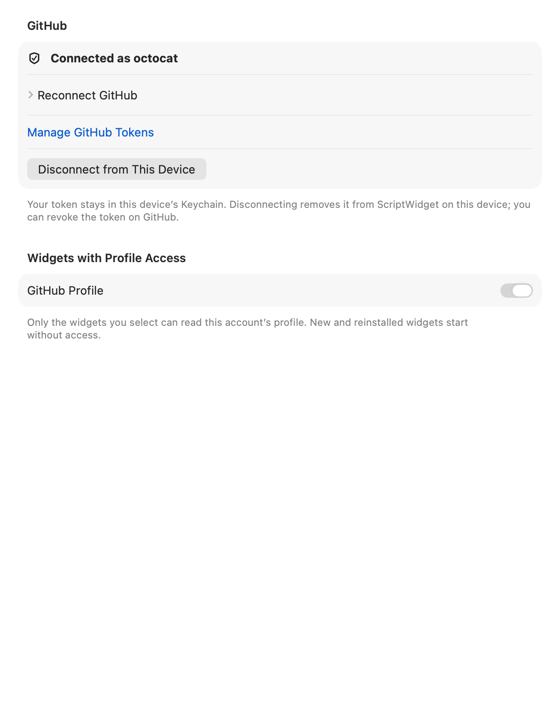
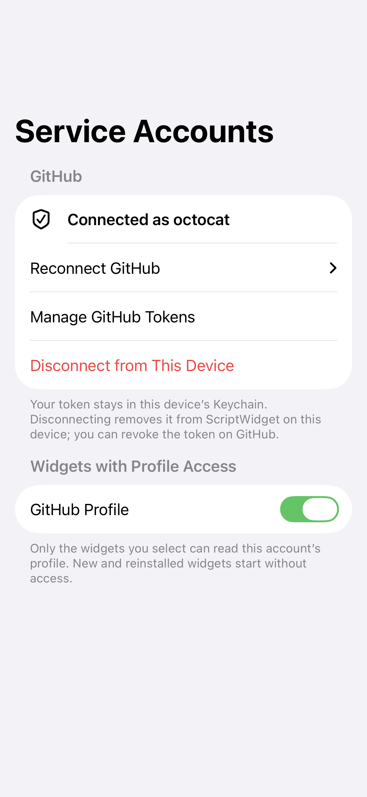

# Native service account foundation

The supported connected service is GitHub. Account connection, verification, per-installed-widget approval and disconnect are managed in the shared native Settings view. Widgets read the [Connected Services API](services-api.md); scripts cannot initiate authentication, choose account IDs or request arbitrary authenticated URLs.

Credentials and owner grants are stored atomically in a dedicated service Keychain group. The shared app/widget coordinator serializes transactions without holding a lock across HTTP. Connection and credential revisions prevent stale UI or in-flight results from restoring revoked access. Reconnecting creates a new connection and does not inherit widget grants. Service credentials remain separate from AI credentials and are not exported to packages, snapshots, prompts, logs or browser mocks.

The native broker only sends the fixed GitHub profile GET, rejects redirects and bounds time/bytes. The returned profile omits arbitrary provider fields. Runtime calls require a valid installed owner, services permission, network and matching host declaration, with shared query/network budgets and cancellation. Authority is rechecked before dispatch and before delivery. Locked/corrupt storage fails explicitly instead of pretending the user disconnected.

The conditional Spotify implementation, system authentication flow, token exchange/refresh, callback/client configuration, playback DTO/operations, internal write ledger, UI and Web fixtures have been removed. There is no pending Spotify setup requirement or future control task in the current plan. Historical implementation/testing records do not describe current supported behavior.

Tests use an isolated in-memory Keychain and private URLProtocol. They cover credential validation/redaction, account/connection/owner binding, grant revocation, stale revisions, secure-store failure, endpoint restrictions, response bounds and cancellation. Actual system Keychain sharing and device acceptance must be recorded separately. See [release readiness](release-readiness.md) and the current [A/B plan](widget-capabilities-plan.md).

The actual native Settings view after removal, using an isolated sample account (not a live provider login):

