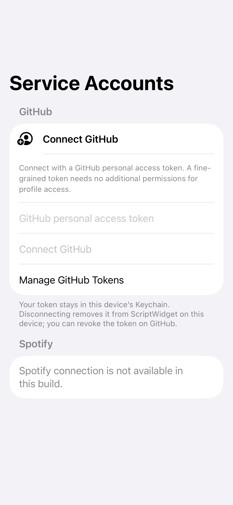
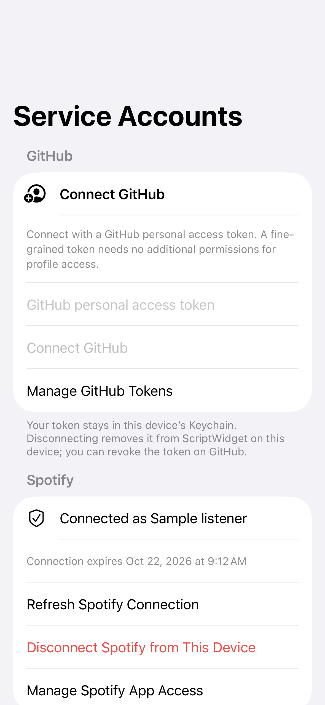
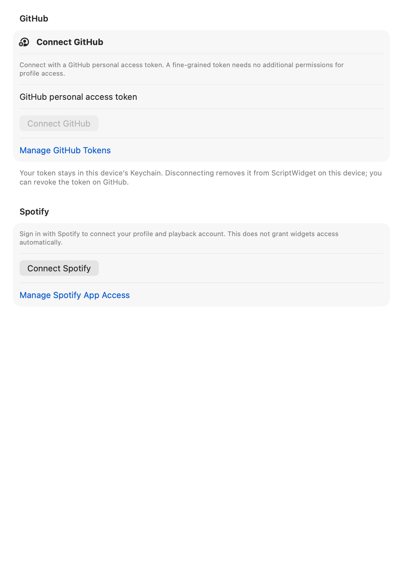

# Native service account foundation

Status: M4 development. Native GitHub connection settings verify a personal access token through a bounded HTTP reader, save the connection in Keychain, let the user select individual widget owners, and disconnect locally. The installed-owner `$services.status("github")` / `$services.profile("github")` bridge, GitHub Profile template and editable Web mocks are integrated. Connecting an account still grants no widget automatically. Spotify now has a native system-authentication account flow, profile verification, explicit foreground refresh and atomic credential rotation. Its application Client ID is deliberately empty in shipping metadata, so its connection section reports unavailable. Provider registration, real account acceptance, public Spotify script integration and music controls remain open. See [Connected Services API](services-api.md) for the public contract.

Credentials are stored in a dedicated service-only Keychain group shared by the app and widget extension. The app-specific default group remains first in each entitlement list, preserving the existing AI credential boundary. The runtime accepts only the signed group configured in the native bundle, with the fixed service-group suffix; an unresolved build variable, missing group or AI/default group fails closed. macOS uses the Data Protection Keychain. Items are device-only, non-synchronizing and available after first unlock; reads do not present an authentication dialog. A locked or unavailable Keychain is an error rather than an empty account list. Real sharing requires a properly signed build and has not yet been tested on a physical device.

Credential envelopes are versioned, bounded to 16 KiB and tied to a service, local account UUID, credential revision and native OAuth client. Token strings cannot contain header injection. Spotify expiry is bounded relative to issue time, and refresh cannot change account, client or granted scopes. Unknown fields/versions and malformed stored records are rejected. Credential and request descriptions are redacted; no credential object or raw request is exported to JavaScript or stored in package files, UserDefaults, app-group snapshots or AI context.

The Spotify authorization session uses system randomness, PKCE S256, a five-minute lifetime and the exact native callback URI. It rejects wrong origins, paths, state, duplicate parameters and replay. A shared session can redeem only one callback, including concurrent deliveries. Codes/verifiers and refresh tokens go only in form-encoded POST bodies to the fixed Spotify token endpoint; they are not URL query parameters. The connection UI must obtain its client configuration from the trusted native application, not imported widgets or plugins. Spotify deployment still depends on an appropriately registered application and its [quota/access requirements](https://developer.spotify.com/documentation/web-api/concepts/quota-modes); this foundation is not evidence of production eligibility. The protocol follows [Spotify's PKCE flow](https://developer.spotify.com/documentation/web-api/tutorials/code-pkce-flow).

The Spotify account flow uses the dedicated callback `scriptwidget-spotify-auth://oauth/spotify/callback`, registered in both native app plists. It does not accept the ordinary `scriptwidget://` action scheme. Spotify's [iOS app configuration rules](https://developer.spotify.com/documentation/web-api/concepts/apps) require a scheme reserved for Spotify authentication. Ordinary iOS/Mac URL routers swallow this reserved scheme: they never forward callback URLs to another app, reopen themselves, or redeem a code. Only the pending system web-auth session can deliver a callback to PKCE validation. Normal widget links remain registered and keep their existing routing. No prior public OAuth flow or saved user callback configuration is migrated.

Maintainers enable a registered integration by setting the app bundle's `ScriptWidgetSpotifyClientID` to its public Client ID and registering the exact callback in the provider dashboard. The native configuration reader requires both a valid Client ID and the dedicated callback registration. It accepts no package, plugin, mock, URL or script override. An empty or unresolved build placeholder leaves the UI unavailable. Client IDs are not client secrets; never add a client secret to an app bundle. A valid Client ID still does not establish the quota/production eligibility described below.

The shared Settings section uses Apple's [ASWebAuthenticationSession](https://developer.apple.com/documentation/authenticationservices/aswebauthenticationsession) with an ephemeral browser preference and a one-use driver. The system presents the provider page; the app never collects a Spotify password. A small native view bridge identifies the actual presenting window without application singletons; references to it are weak, and a closed window cannot silently select another scene. Leaving Settings or pressing Cancel invalidates the attempt before cancelling the browser/HTTP handle. Late or repeated browser, token and profile callbacks cannot advance a new attempt or write its account.

After a valid callback, the controller exchanges the code and verifies the resulting credential through the fixed Spotify profile reader before an atomic connection save. It checks the original connection before each outgoing stage and before commit. A new account has no owner grants. Explicit Refresh also verifies the same provider subject before replacing the credential; account, client, scope and owner-policy identity remain intact. Disconnect is local to this device; use Manage Spotify App Access to revoke provider authorization. This settings flow does not yet grant Spotify operations to scripts.

`ScriptWidgetSpotifyTokenClient` redeems a validated single-use session or builds a refresh request from the existing native credential. Its ephemeral transport rejects redirects/cookies/cache/authentication challenges and enforces a 16 KiB header/streaming response budget before decoding. Completion is single-use; cancellation cancels the underlying task and delivers only a sanitized cancellation result, discarding late or duplicate responses. Issuance uses the response-receipt clock; omitted refresh tokens/scopes are preserved only through the validated previous credential. Neither method authenticates an account by itself: callers must still verify the provider subject, current native connection authority and consent before saving or using the credential.

The connection store atomically replaces a Spotify credential while retaining the exact policy, provider subject and label. It requires the original account/connection, credential and policy revisions to still match. It rejects account/client/scope changes, backdated issue times or reused credential revisions, disconnected/reconnected accounts and concurrent grant changes. A failed Keychain write leaves the prior record intact. A foreground app lease now serializes interactive sign-in/refresh across Settings windows without holding a storage lock over HTTP. Cancellation, completion and model teardown release only their own lease. This is not a persistent cross-process lease or automatic widget refresh. If the provider rotates a token but the user cancels or local authority changes before commit, a fresh connection may be required; old results never restore revoked local access.

The live connection store writes one atomic, versioned Keychain item per service containing its credential, account/connection, policy revision, minimal verified account label and up to 32 owner grants. The lower-level vault also has separate credential/policy helpers for focused tests; those keys are not live connection authority. New connections grant no widget access. Grants use the native storage owner UUID, never a package name or public manifest ID. They list concrete operations, cannot cross accounts/services, reject stale edits and can be revoked. App-group status/cache files do not authorize outgoing requests. The runtime bridge obtains owner and network facts from the current native execution snapshot and validated package manifest; scripts cannot supply them.

Fixed operation plans currently describe these first-party requests:

| Operation | Method and path | Required Spotify scope |
| --- | --- | --- |
| `github.profile` | `GET api.github.com/user` | — |
| `spotify.profile` | `GET api.spotify.com/v1/me` | `user-read-private` |
| `spotify.playback` | `GET api.spotify.com/v1/me/player` | `user-read-playback-state` |
| `spotify.pause` / `spotify.resume` | `PUT …/player/pause` / `…/player/play` | `user-modify-playback-state` |
| `spotify.next` / `spotify.previous` | `POST …/player/next` / `…/player/previous` | `user-modify-playback-state` |

The builder verifies the private owner grant, service/account/connection, provider scopes, network permission and every service host. Spotify also needs the token-refresh host allowed. Writes additionally require a native user action and a stable request UUID. A request plan alone does not implement durable replay prevention: the receipt layer must be connected before exposing writes. The read broker now denies all redirects, bounds streamed responses to 128 KiB, extracts typed fields, rejects recognized credentials echoed in selected strings (including JSON-escaped strings), and revalidates connection authority before dispatch and after decoding. The JavaScript bridge also checks installed execution identity, manifest permissions, shared data/network budgets and current connection authority on delivery. The reader explicitly refuses every write operation, including otherwise valid action plans, until durable receipts are integrated. Arbitrary authenticated URLs, headers and request bodies are not accepted by these plans. Data Source Plugin 1.0 remains a declarative, unauthenticated HTTPS mapping.

GitHub requests pin API version `2026-03-10`. Its [authenticated-user endpoint](https://docs.github.com/en/rest/users/users#get-the-authenticated-user) permits fine-grained tokens without additional permissions; optional private response fields depend on the token's authorization. The typed profile adapter preserves missing private counts as null rather than zero, and omits email, location, provider headers and unrelated sensitive fields. Spotify profiles expose only provider subject/display name; the playback projection exposes bounded track/episode metadata and active/restricted device flags, without device IDs or arbitrary provider URLs. A 204 playback response means no active playback; an empty 200 response is malformed.

The iOS Settings → Services → Service Accounts screen and Mac Settings → Services screen share the same controller. The token field is secure, is cleared when submitted or when leaving, and is never stored in preferences or drafts. Verification may be cancelled; late callbacks cannot save a token after cancellation or overwrite a connection changed on another screen. Reconnecting creates fresh account/connection UUIDs and clears owner grants. An expected policy revision is required for each grant/disconnect mutation. Native library directory bindings determine owner UUIDs; imported names or IDs cannot choose them. A retired or replaced owner and a switched library fail validation before granting.

The connection transaction uses the existing app-group file lock, never holds that lock over HTTP, and keeps all credential/policy data in Keychain. Disconnect removes the local connection atomically and invalidates in-flight readers. It does not revoke a user-owned PAT on GitHub; the screen links to GitHub token management. Other screens must reload stale drafts instead of silently overwriting a newer connection. A locked, corrupt or unavailable store is an error, not evidence of a disconnected account.

The HTTP reader uses ephemeral URLSession instances with no cookies, credential storage or response cache. Each request has serial delegate delivery, a five-second request/six-second resource timeout, a streaming byte limit, strict JSON/status validation, no redirect following and sanitized errors. A request does not retry automatically. The public scripts layer registers cancellation with its execution session, shares the ordinary fetch concurrency/total budget, rechecks execution identity and connection policy, and verifies the returned provider subject against the saved account. A status query makes no HTTP request and cannot promise the token is still valid remotely.

`node Scripts/test-service-authorization.mjs` runs the same native implementation and XCTest methods without launching an app. Its 44 cases use an in-memory Keychain and fixed sample tokens. URLSession tests use a private URLProtocol fixture for streaming, redirects, HTTP/MIME rejection and make zero external network requests. Added token-client/rotation cases cover callback non-dispatch/replay, cancellation, duplicate completion, refresh identity, malformed/oversized responses, the lower streaming budget and stale/failed credential commits. The tests are also compiled into both native test targets, and the probe is included in `Scripts/release-readiness.sh`. Native app-hosted controller tests additionally exercise verify/save/grant/disconnect, cancellation, retired owners, stale drafts and concurrent connection replacement. Opt-in native screenshots cover disconnected, connected and locked states on each platform. These fixtures do not prove real service login or signed Keychain sharing.

App-hosted `SpotifyAccountsFlowTests` additionally cover configuration and actual plist registration, exchange/verify/save ordering, cancellation at each sign-in stage, stale callbacks and competing connections, refresh subject matching, disconnect during refresh, shared foreground leases and the actual presentation-window bridge/system callback matcher. Screenshot fixtures render unconfigured, ready, pending and connected Settings states with an in-memory Keychain and fake browser/HTTP callbacks. They do not launch a live provider login or prove production eligibility.

Still pending: registered provider configuration and real system-browser/account acceptance; signed app/widget Keychain sharing; public Spotify runtime reads/owner grants, background refresh and playback receipts/control; Apple Music capability/device checks. No live user account was connected during automated verification. Web Studio retains its existing editable samples and explicit unavailable Spotify contract, with no real credentials or browser sign-in.

Provider requirements were rechecked on 2026-10-22: [development mode](https://developer.spotify.com/documentation/web-api/concepts/quota-modes) requires an owner Premium account and allows up to five allowlisted users; the wider-distribution partner requirements are separate. The [July 2026 update](https://developer.spotify.com/blog/2026-07-23-web-api-quota-updates) raises the developer Client ID limit to 25 and shares development quota across them. A Client ID alone is not proof of production eligibility. Until native configuration and actual account acceptance are supplied, the public Spotify status and Web behavior stay explicitly unavailable rather than pretending that the token-client tests establish live access.

Native screenshots use only in-memory sample credentials and the octocat fixture. [Before connection](images/service-accounts-ios-disconnected.png), [after connection and owner selection](images/service-accounts-ios-connected.png), and [Mac account settings](images/service-accounts-macos-connected.png) show the actual shared settings view. They are not screenshots of a signed live-service authorization.

| Default unavailable Spotify | Sample connection after native verification |
| --- | --- |
|  |  |

