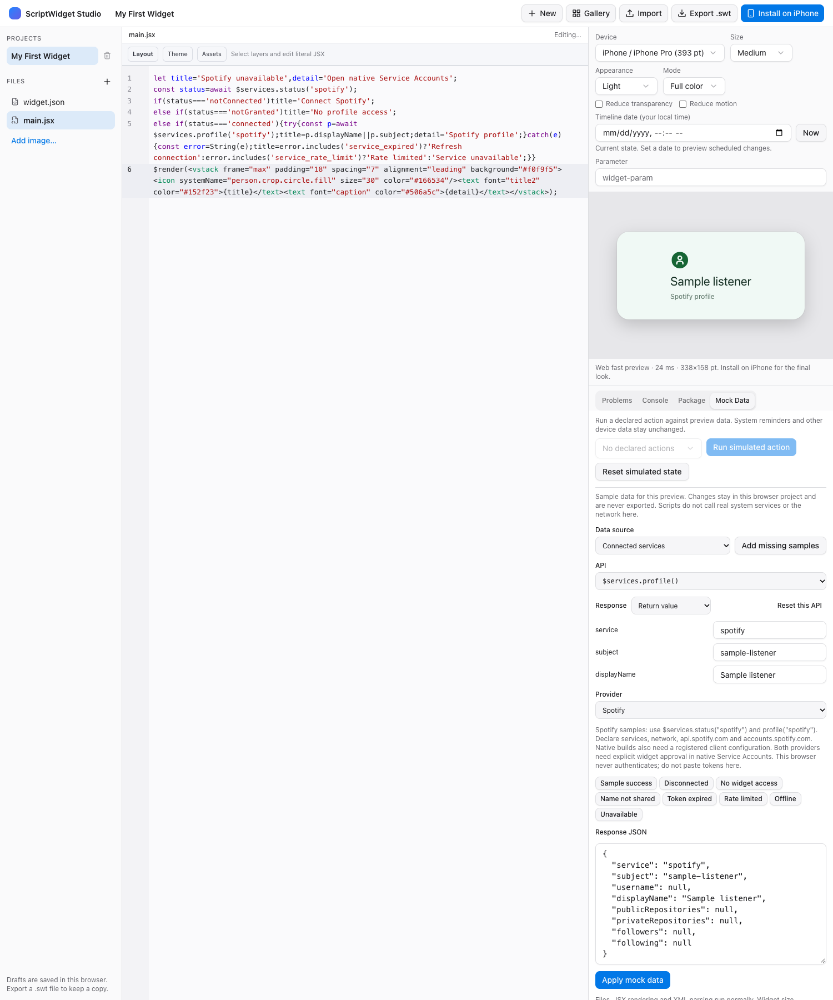
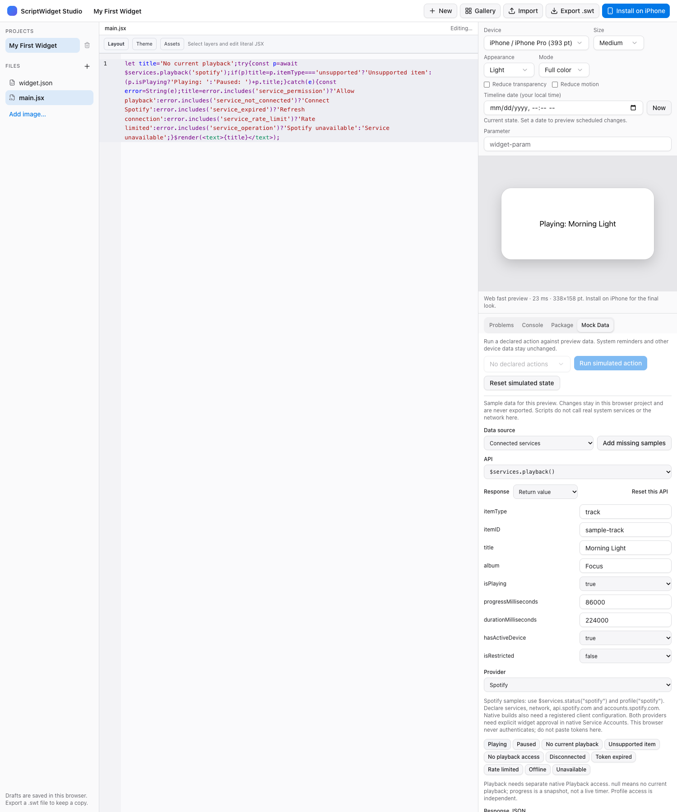

# Connected Services API (Runtime 1.4)

`$services` reads a user-connected account through a fixed native request broker. Supported profile providers are `github` and conditionally configured `spotify`. Account connection and per-widget approval live in ScriptWidget Settings > Service Accounts (iOS) or Settings > Services (Mac). Web Studio uses editable samples; it does not authenticate or contact the provider.

```json
{
  "permissions": ["services", "network"],
  "networkDomains": ["api.github.com"],
  "minimumRuntimeVersion": "1.4"
}
```

These are fields within a full Package 2.0 manifest. A real installed widget owner and the `services` permission are required for both methods. `profile` also requires the declared network permission/domain and an explicit native grant for that owner. A legacy or uninstalled template preview cannot access native accounts. Imports and reinstallation cannot select another widget's owner UUID or inherit its account grant.

```jsx
const status = await $services.status("github");
if (status === "connected") {
  const profile = await $services.profile("github");
  $render(<text>{`${profile.username}: ${profile.publicRepositories} repos`}</text>);
} else {
  $render(<text>Connect and allow this widget in Service Accounts.</text>);
}
```

`status(service)` makes no HTTP request. It resolves to `notConnected`, `notGranted`, `connected`, or `unavailable`. Connected means a local account and this owner's grant exist; it does not guarantee that the provider still accepts the token. A locked, corrupt or unavailable secure store rejects with a sanitized error rather than pretending that the account was disconnected. `unavailable` covers unsupported provider integration or missing native service configuration.

`profile("github")` performs a fixed authenticated `GET https://api.github.com/user`. The account is chosen in native Settings; a script cannot select an arbitrary account, URL, request header or token. The response has exactly these fields:

| Field | Type / meaning |
| --- | --- |
| `service` | `"github"` |
| `subject` | Provider user ID as a string |
| `username` | GitHub login, including managed-user suffixes |
| `displayName` | String or null |
| `publicRepositories` | Nonnegative integer |
| `privateRepositories` | Nonnegative integer or null when not shared |
| `followers`, `following` | Nonnegative integer or null |

A missing private count is not zero. The token's provider permissions determine which private fields are returned; the [GitHub authenticated-user endpoint](https://docs.github.com/en/rest/users/users#get-the-authenticated-user) supports fine-grained tokens with no additional permission for basic profile access. ScriptWidget omits email, location, arbitrary provider fields and response headers. Credentials stay in the dedicated native Keychain group, not in scripts, package exports, preferences, snapshots or AI prompts. No credentials should be pasted into Web mocks.

`profile("spotify")` reads the fixed `GET https://api.spotify.com/v1/me` endpoint after native account connection and explicit **Profile access** approval for the installed widget. It uses the same eight-field response shape: `service` is `"spotify"`, `subject` is the provider user ID, and `displayName` is a string or null. `username`, `publicRepositories`, `privateRepositories`, `followers` and `following` are always null; unsupported statistics are not zero. The package must declare both `api.spotify.com` and `accounts.spotify.com` in `networkDomains`, alongside `services` and `network` permissions.

Native Spotify reads require the registered public Client ID in the app and widget bundles to match for that platform. An absent configuration keeps `status("spotify")` at `unavailable` and profile reads at `service_operation`; credentials from another Client ID are rejected. Shipping Client IDs remain empty until a registered integration is supplied. Unknown providers reject with `service_operation`. See [native configuration and acceptance boundaries](service-accounts-foundation.md). Conditional playback reads are described below; playback controls remain under development. Scripts cannot initiate sign-in or token refresh.

```jsx
const status = await $services.status("spotify");
if (status === "connected") {
  try {
    const profile = await $services.profile("spotify");
    $render(<text>{profile.displayName || profile.subject}</text>);
  } catch {
    $render(<text>Unable to load Spotify. Check the connection in Settings.</text>);
  }
} else {
  $render(<text>{status === "unavailable" ? "Spotify is unavailable in this build." : "Connect and allow this widget in Service Accounts."}</text>);
}
```

## Spotify playback snapshots

`await $services.playback("spotify")` uses the same signed configuration, installed-owner, `services`/`network`, fixed-host and execution boundaries as profile reads. **Playback access** is a separate native toggle for each widget. Profile approval does not grant playback; playback approval does not grant profile. `status("spotify")` continues to report profile access, so a playback-only widget should call `playback` directly and handle its errors. The native credential also needs `user-read-playback-state`; importing a package cannot grant provider scopes.

The fixed request is `GET https://api.spotify.com/v1/me/player`. An empty 204 response resolves to **null**, meaning no current playback. A valid 200 response resolves to exactly these ten fields:

| Field | Type / meaning |
| --- | --- |
| `itemType` | `track`, `episode` or `unsupported` |
| `itemID` | String or null; no arbitrary provider URL |
| `title`, `album` | String or null; album is the show name for an episode |
| `artists` | Up to eight bounded names; empty for episodes/unsupported items |
| `isPlaying` | Boolean |
| `progressMilliseconds`, `durationMilliseconds` | Integer milliseconds or null, bounded to seven days |
| `hasActiveDevice`, `isRestricted` | Boolean flags, with no device ID/name |

Unknown/missing item metadata becomes `unsupported`, preserving only playback flags and optional progress; item ID, title, album and duration are null and artists is empty. An empty 200 body is malformed, not a no-playback success. Progress is the value at query time; the widget does not stream audio, synchronize a live clock or change playback. Treat withheld values as unknown. GitHub and unknown providers reject this method with `service_operation`.

Web Studio selects **Spotify → $services.playback()** and provides editable title/JSON plus Playing, Paused, No current playback, Unsupported item, No playback access, Disconnected, Token expired, Rate limited, Offline and Unavailable cases. Its separate `services.spotify.playbackGranted` mock boolean cannot grant native access. Old fixtures without a playback grant remain denied. Error states and mock values never bypass package or shared-query limits.

Both native and Web integrations use existing platform/framework primitives; no Spotify SDK, App Remote framework or browser playback SDK is added. Native login is Apple's system authentication session, HTTP uses URLSession and credentials use Keychain. The official [playback endpoint](https://developer.spotify.com/documentation/web-api/reference/get-information-about-the-users-current-playback) documents the read scope and 204 response. When building a UI that displays actual Spotify metadata, follow Spotify's [branding and attribution requirements](https://developer.spotify.com/documentation/design), including the Spotify brand and an accessible Spotify link. This API does not provide streaming or bypass provider eligibility.

Each method consumes one of the execution's eight shared data queries. Profile requests also share ordinary native fetch limits (eight concurrent, 32 total), have bounded ephemeral HTTP transport, reject all redirects and limit streamed responses to 128 KiB. Web profiles share the preview's existing network budget. Requests recheck installed execution identity and private connection authority before sending and before delivery. Disconnecting, reconnecting or changing the owner's grant invalidates pending results. A provider response for a different user ID is rejected. No automatic retries, token refresh, profile persistence, arbitrary authenticated fetch or writes are exposed.

Future timeline entries and Live Activity/Dynamic Island presentations reject live service queries with `timeline_read_only`. Read in the current execution and reuse a display snapshot when composing those presentations. Do not embed tokens in Live Activity state.

Common failures include `service_permission`, `service_not_connected`, `service_expired`, `service_locked`, `service_credential`, `service_rate_limit`, `service_unavailable`, `query_limit`, and `network_limit`. Catch them and show setup/reconnect/retry states; never turn a failure into plausible zero counts.

Web Studio's Connected Services panel has separate GitHub and Spotify selectors, healthy default samples, editable fields/JSON and provider-specific scenarios. Spotify includes disconnection, missing widget access, an unshared name, expiry, rate limits, offline and unavailable states. GitHub retains zero-count and unshared-private-count cases. Spotify overrides live under `services.spotify` in mock JSON; legacy fixtures without that entry remain unavailable. Neither the editor nor the preview accepts credentials. The browser applies the same manifest/host and query-budget boundaries. Response overrides cannot bypass manifest/network checks, a denied status, unsupported providers or query budgets. Mock profile objects accept only the documented fields. Mock data stays in the browser draft and is not exported with the package.

[GitHub Profile template](../Shared/ScriptWidgetRuntime/Resource/Script.bundle/template/GitHub%20Profile/main.jsx) uses these APIs with all eight widget families and explicit setup/error states. Real account authorization, signed app/widget Keychain sharing and physical-device delivery still need acceptance; deterministic tests and sample screenshots do not prove those checks.

GitHub.com managed-user logins may include an underscore and enterprise shortcode within the 39-character limit, as described in [GitHub username normalization](https://docs.github.com/en/enterprise-cloud%40latest/admin/managing-iam/iam-configuration-reference/username-considerations-for-external-authentication). Native and Web validation accept those names; arbitrary enterprise server hosts are not part of this API.

Native fixture captures: [sample profile](images/github-profile-sample.png), [setup state](images/github-profile-setup.png), and [Web Studio mock controls](images/github-profile-web-studio.png). These are sample accounts and actual rendering/UI, not a live provider authorization.




