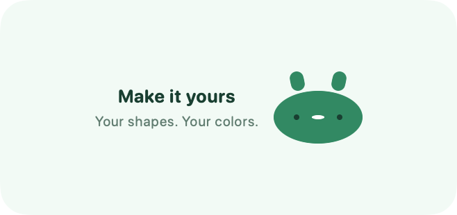
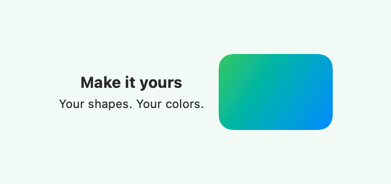
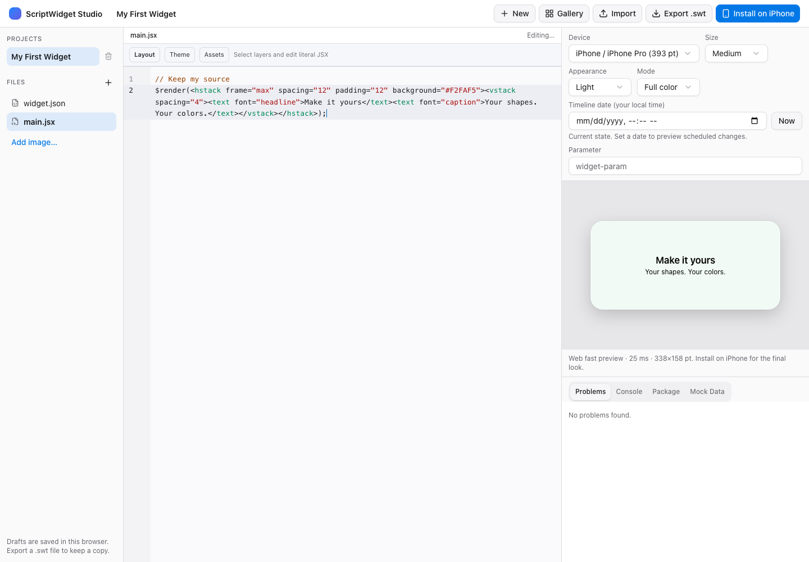
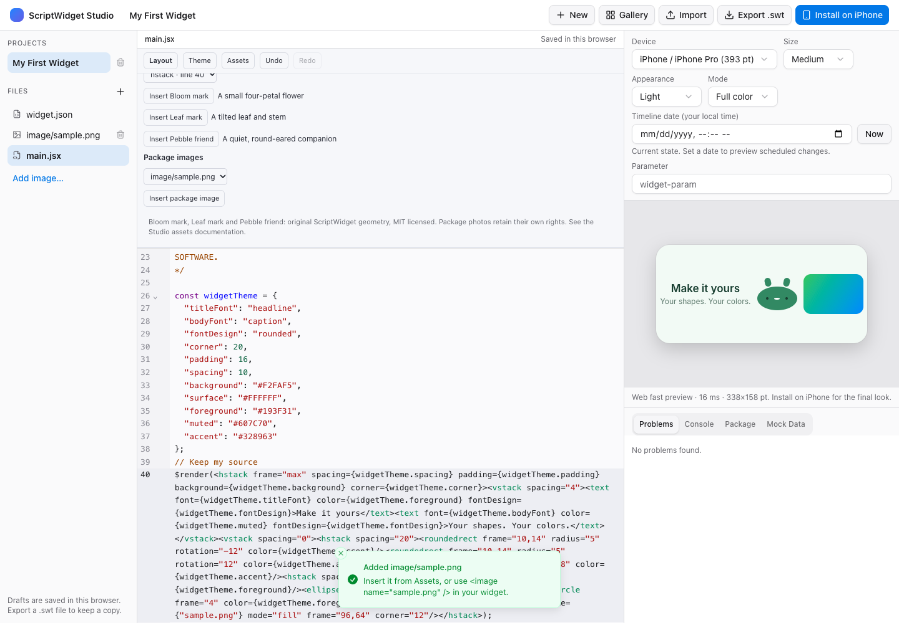
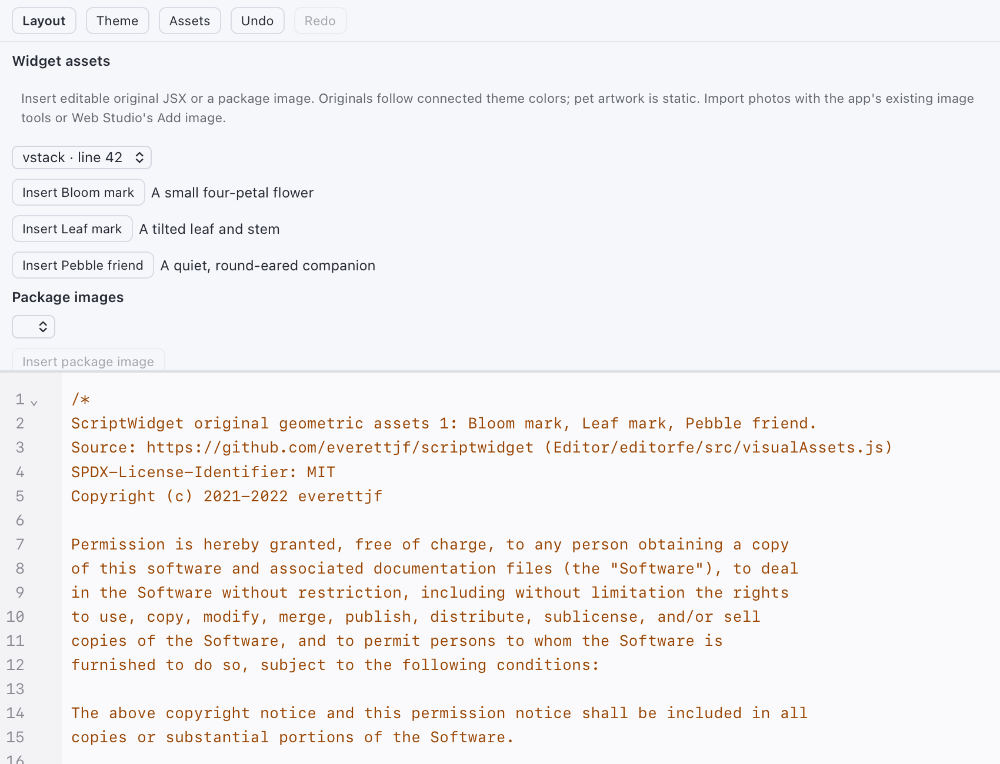

# Studio assets

Open **Assets** above the editor on iOS, macOS or Web Studio. Select a destination stack/grid, then insert an original mark, pet or package image. **Layout Starter** is a suitable starting point; copying it from the built-in templates or Gallery keeps an ordinary Package 2.0 project. Layout can subsequently select, reorder, edit or delete the inserted JSX.

The destination must contain literal JSX children. Dynamic maps, custom components and unsupported structures stay in Code. Every insertion checks the current source, respects read-only documents, uses one Undo transaction and follows the normal save/recovery/preview path. Existing code and resources are preserved. Source/layer/depth limits still apply.

## Original geometry and themes

| Asset | Type | Source and reuse |
| --- | --- | --- |
| Bloom mark | Four-petal geometric icon | Original ScriptWidget ellipse/circle composition; MIT |
| Leaf mark | Geometric icon with stem | Original ScriptWidget ellipse/rounded-rectangle composition; MIT |
| Pebble friend | Static companion artwork | Original ScriptWidget ear/body/face composition; MIT |

All three are authored in [visualAssets.js](../Editor/editorfe/src/visualAssets.js). They contain native JSX shapes and require no downloaded artwork, SF Symbol rendering or network permission. Their source and full repository MIT notice are inserted into the widget file on first use, retained once on repeated insertion, and carried by package export. They can be recolored and rearranged in Code/Layout.

When a supported top-level [widgetTheme](widget-themes.md) declaration exists, the artwork uses its accent, foreground and surface tokens. Otherwise it uses literal Meadow colors. The panel does not infer an arbitrary project's palette. Pebble friend is static artwork; the existing **Pocket Pet** template provides the separate persistent care journal and interactions. Inserting artwork does not add actions or records.

Actual native rendering of the inserted companion and a package image:

| Themed original | Local image |
| --- | --- |
|  |  |

The image shown here is an original programmatically drawn gradient used as a test fixture, not a user's photograph. Its pixels are also retained in `Web/preview-engine/test/parity/assets/Sample.png` for offline package and browser acceptance.

## Package photos

Use the existing native image import tools or Web Studio's **Add image…** to put images into the package. The Assets picker lists PNG, JPEG and WebP files directly inside `image/`. On Web it updates when files change; native hosts expose **Refresh images**, and reopening the document also refreshes the list. Example:

```jsx
<image name={"My photo.png"} mode="fill" frame="96,64" corner="12"/>
```

The renderer's existing `name` contract reads `image/My photo.png`; arbitrary paths and nested image paths are not supported by this picker. GIF/HEIC/SVG are not offered here. Existing GIF/code workflows remain available separately. The inserted frame/mode/corner can be edited afterward. A supported extension identifies a candidate resource; actual image decoding still uses the existing bounded image pipeline and may reject invalid files.

The list contains names only, at most 256 eligible images, with 255-byte filenames. A list or native image directory exceeding 4096 entries is rejected. Traversal, backslashes, controls, ambiguous case/Unicode names and unsupported formats are filtered; native enumeration also checks package access, canonical boundaries, regular-file type and symbolic/hard links. It does not enumerate the system photo library, decode images or initiate remote downloads. An unavailable resource list never grants extra permissions. Photos retain their original ownership and reuse terms.

## Shared editor bridge

Studio protocol version 1 accepts an additive optional `resources` array in `document.open.payload`. The app-only `document.resources` request uses the current document ID; native hosts return `{result:"ok",documentID,resources}` only for that document. The remote native Studio host returns its current package file list through the existing authenticated API. The frontend filters every list before displaying it.

Refresh responses must match the requested document ID and document generation. Late replies after switching or reopening a document are rejected. Resource metadata effects neither modify source nor create undo entries; new native document states start with an empty list. In Web Studio, React updates the same field from the current project's package files. The new bridge handler does not provide a script/runtime API or serve user images through the static editor bundle scheme.

## Acceptance

Tests use the actual bundled WKWebView for insertion/save/Undo/Redo, image-list refresh, wrong/late document replies and read-only protection. Eight original/photo cases, with and without connected themes, execute in native JSC and compare exact edited source/canonical trees with Web; export/import retains source, full license and image bytes. Chrome uses the actual image input and pointer clicks to check live resource updates, decoded image preview, save/reload, history and 390px sizing. These checks do not replace physical WidgetKit, signed-container or extension-memory acceptance.

| Before | After original and package image insertion |
| --- | --- |
|  |  |

The same controls in the actual native WKWebView:


