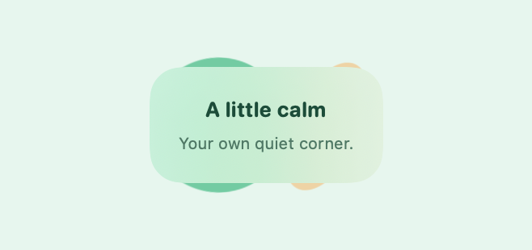
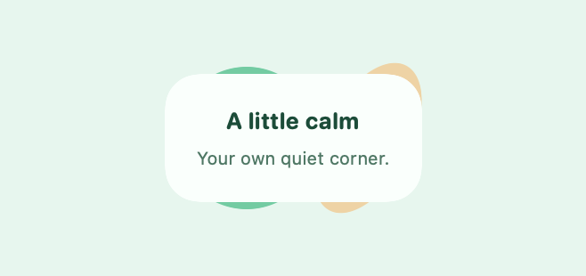
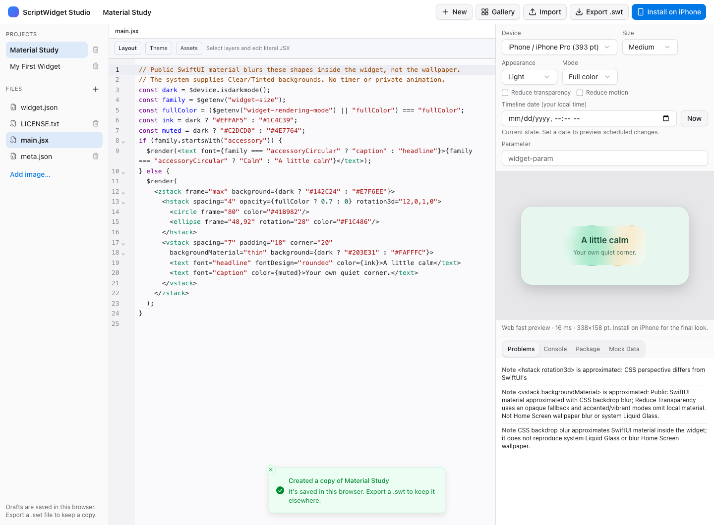
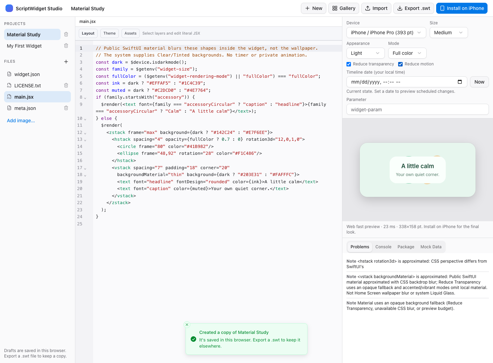

# Visual effects and fallbacks

**Material Study**, in built-in templates and Gallery, demonstrates an original frosted card and a fixed 3D tilt. It needs Runtime API 1.4, no permissions and no network. In Layout select the card's VStack, choose `backgroundMaterial`, then Apply a thickness or `none`. Undo/Redo and Package export use the existing source-preserving pipeline.

```jsx
$render(
  <zstack frame="max" background="#E7F6EE">
    <circle frame="80" color="#41B982"/>
    <vstack padding="18" corner="20" backgroundMaterial="thin"
      background="#FAFFFC" rotation3d="5,0,1,0">
      <text font="headline">A little calm</text>
    </vstack>
  </zstack>
);
```

## Capability assessment

| Effect | Native support | Web support and boundary |
| --- | --- | --- |
| Frosted material | Public SwiftUI Material; ultraThin/thin/regular/thick/ultraThick | Explicit CSS backdrop-blur approximation; opaque fallback if CSS blur is unavailable |
| Reduce Transparency | Opaque base plus authored `background` color/gradient | Preview checkbox applies the same fallback policy without editing source |
| Reduce Motion | Removes static 3D tilt and suppresses legacy animation modifiers | Preview checkbox removes 3D transforms and freezes CSS/GIF preview frames |
| Clear/Tinted Liquid Glass | WidgetKit owns the system container appearance; local material is omitted in accented/vibrant mode | Neutral wallpaper stand-in and mode diagnostics; not a replica of the system material |
| Static depth | Public `rotation3DEffect` projection using `degree,x,y,z` | CSS perspective approximation; no device-motion reading or parallax |
| Content-update animation | System-controlled widget/Live Activity updates | A continuously running browser effect is not evidence of native continuous playback |
| Wallpaper matching/export | Existing native calibrated crop and PNG export | Existing package-image preview works; a guided Web crop/export interface remains unfinished |
| Live/spatial system wallpaper | No control exposed to scripts/widgets by this implementation | No fake claim of changing the operating-system wallpaper |

Apple documents Material as blending content **inside** an app/widget, rather than the Home Screen behind it. The framework type is available from iOS 15/macOS 12, within this project's deployment targets. [SwiftUI Material](https://developer.apple.com/documentation/swiftui/material).

Clear/Tinted appearance is a separate system treatment, driven by accented rendering and removable container backgrounds. Existing `widgetAccentable` and image `accentedRenderingMode` remain the relevant authoring controls. [WidgetKit Liquid Glass guidance](https://developer.apple.com/documentation/WidgetKit/optimizing-your-widget-for-accented-rendering-mode-and-liquid-glass).

Apple limits widget/Live Activity data-update animations to two seconds and may suppress them in Always On. That is not a guarantee of permanent clock, GIF or background animation. [Animating data updates](https://developer.apple.com/documentation/widgetkit/animating-data-updates-in-widgets-and-live-activities).

## Material policy and budgets

`backgroundMaterial="none"` preserves normal background behavior. Unsupported material names are ignored. Enabled material uses the authored `background` as a fallback, not as an opaque layer beneath the blur. Reduce Transparency composites that fallback over white/black, so alpha in a supplied color cannot defeat the opaque fallback. Accented/vibrant rendering omits local material for system legibility. Root material goes through the existing removable WidgetKit container background; app preview and nested cards use the same policy.

At most **four** enabled material backgrounds are permitted per resolved tree. Native and Web execution reject a fifth before drawing. Spacer ignores material as it ignores other background properties. Browser rendering also falls back after its own material budget. This bounds graph complexity; it does not certify a particular WidgetKit memory footprint. No timers, background sensors, custom shaders or separate render loops are added.

The native host uses the real read-only accessibility environment. A custom, internal EnvironmentKey can supply trusted preview/test overrides without setting Apple's private accessibility values; scripts cannot modify it. Web controls start from browser accessibility media preferences and allow local simulation. These flags are preview state, not widget permissions or exported mock data.

## Static 3D

`rotation3d="5,0,1,0"` means five degrees around the y-axis. Parsing requires four finite numbers and a nonzero axis. Large axes are normalized without overflow; the degree is reduced modulo 360. Malformed/nonfinite/zero-axis values render an unrotated fallback. Reduce Motion removes the tilt. This projects a flat view and does not generate a spatial scene or infer device movement. [SwiftUI rotation3DEffect](https://developer.apple.com/documentation/SwiftUI/View/rotation3DEffect(_:axis:anchor:anchorZ:perspective:)).

## Existing animation compatibility remains open

The existing [clock bridge](../Shared/ScriptWidgetRuntime/Widget/Component/Attributes/Animation/ClockHandRotationEffect.swift) resolves `_ClockHandRotationEffect` dynamically. Swing and the iOS GIF sequencer use that bridge too. These are **not public-API evidence** for continuous WidgetKit animation. This increment preserves their ordinary existing behavior while adding Reduce Motion/reduced-luminance handling to the general animation modifier. Native GIF sequencing still needs the separate compatibility/fallback work; Web's first-frame preview must not be presented as proof of that native behavior.

Material Study uses no such bridge. A release compatibility decision is pending because removing the old path changes existing clock/swing/GIF behavior. App Review 2.5.1 requires public APIs; no App Store readiness or approval is claimed while that decision and verification remain open. [Apple review guidelines](https://developer.apple.com/app-store/review/guidelines/#software-requirements).

## Wallpaper workflow

Use [Wallpaper Match](wallpaper-match.md) for explicit image selection, calibrated crops and PNG export. It does not set the OS wallpaper. macOS has a public app-level desktop-image setter, so it would be inaccurate to claim all platforms lack such an API; ScriptWidget does not expose it to imported widgets or invoke it here. [NSWorkspace desktop image API](https://developer.apple.com/documentation/appkit/nsworkspace/setdesktopimageurl(_:for:options:)).

The separate Web crop/export interface, actual Clear/Tinted/Home Screen behavior, signed WidgetKit delivery and extension/device memory still require work. M5-3 and M5-4 remain open. Native/Web tree equality proves resolved source semantics, not identical GPU blur, system refraction or real-device performance.

## Hosted performance evidence

The final local gate records five 329×155 frames with four material regions per frame, after plain/material/solid warmup. These are **hosted JSC + ImageRenderer app/test process samples**, not a WidgetKit extension budget or device acceptance:

| Host | Material: five frames / sampled footprint delta | Solid fallback: five frames / sampled delta |
| --- | --- | --- |
| Mac | 12.93 ms / 0.30 MiB | 11.75 ms / 0.16 MiB |
| iPhone 17 Simulator | 27.49 ms / 0.72 MiB | 21.98 ms / 0.41 MiB |

The plain-to-all-warmup footprint change was 35.27 MiB on Mac and 0.63 MiB in this simulator run. First-use framework/shader/cache costs therefore must not be hidden behind the small warm-frame deltas. The samples are not a controlled causal comparison or a continuous peak-memory trace. Exact cold/warm values and test attachments are retained in `__Release/capabilities/effects/`; physical extension memory remains unproven.

## Visual evidence

Actual native ImageRenderer output (public Material and trusted accessibility overrides):

| Material | Opaque / reduced-motion fallback |
| --- | --- |
|  |  |

Web Studio uses the matching source and explicitly labels its approximation:

| Material preview | Accessibility simulation |
| --- | --- |
|  |  |
