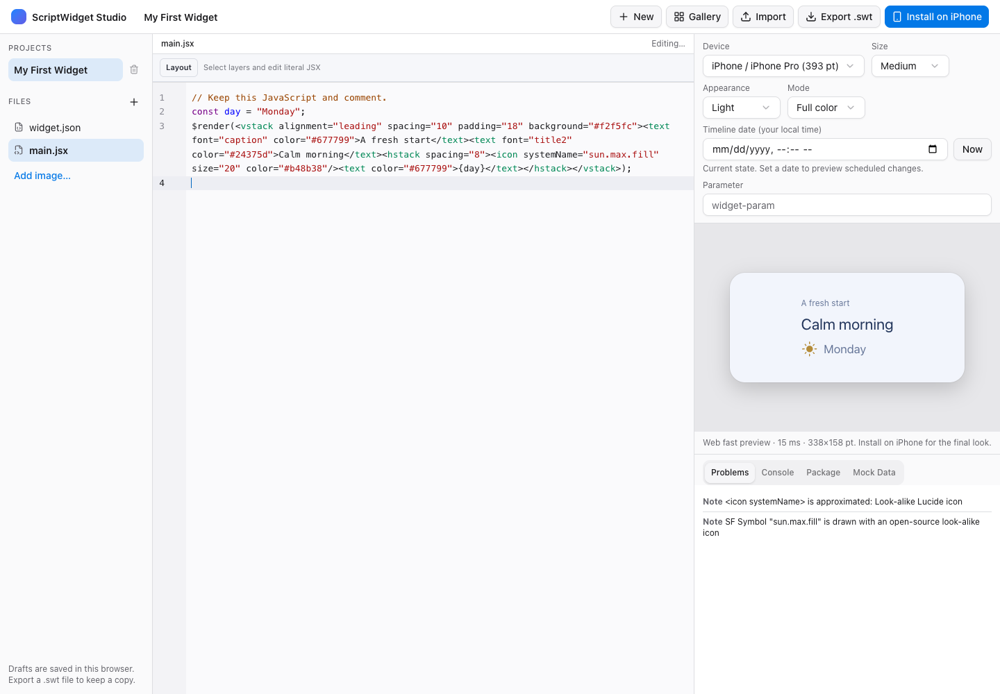
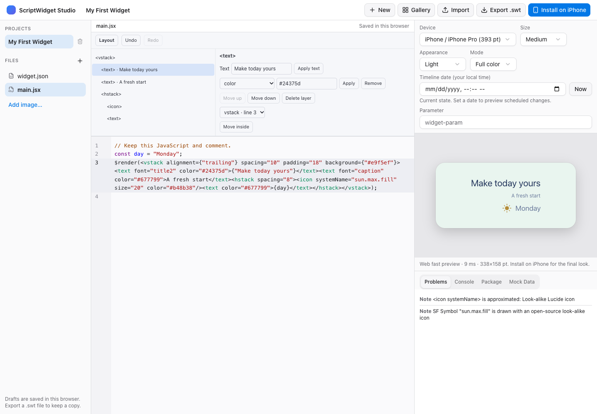
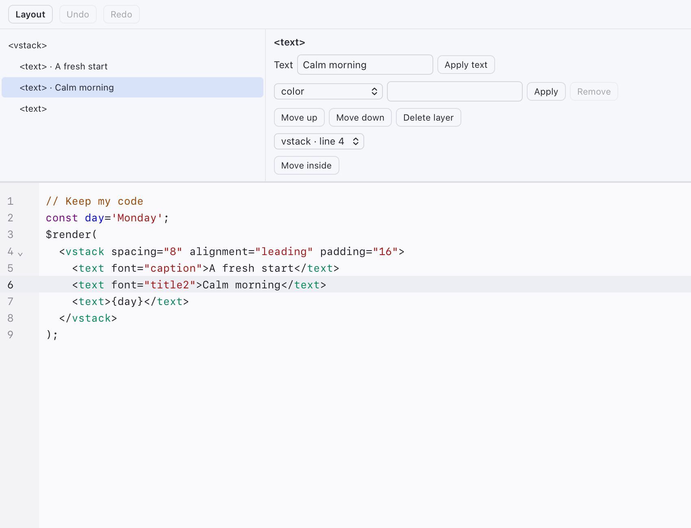
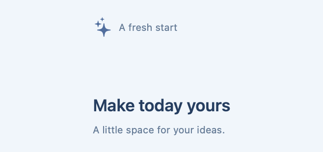
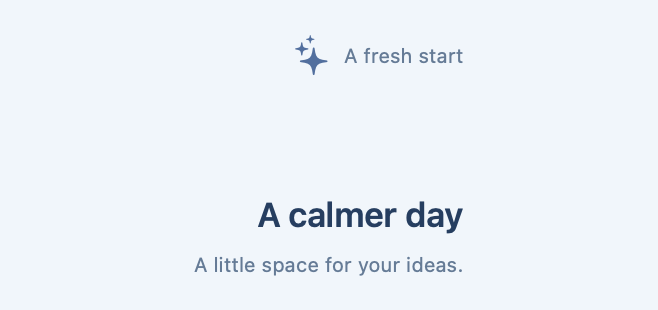

# Layout editing in Studio

Open **Layout** above the CodeMirror editor in the iOS/Mac app or Web Studio. Start with the bundled or Gallery **Layout Starter** template for a composition whose values can all be edited visually. The same model, controls and editing commands ship in both native editor bundles and Web Studio.

Select a layer in the tree, or place the Code cursor inside its JSX. Edit literal text with Apply text. Choose a property to edit colors, font, padding, spacing, alignment and other supported primitive properties, then Apply. The property definitions come from the shared completion metadata; the native component switch remains the runtime authority and normal diagnostics/preview limitations still apply.

Drag a layer before another layer, use Move up/down, or choose a destination and Move inside. These operations apply to literal JSX children of paired VStack/HStack/ZStack/VGrid/HGrid containers, using either native tag spelling or its lowercase form. Add text, stack, spacer and icon create literal JSX children. Delete layer removes the selected child. The root stays in place. Keyboard arrow keys and Home/End navigate the layer tree; buttons provide the same ordering operations without dragging.

Undo/Redo use the existing CodeMirror document history. Each visual operation is isolated as a single undo step, and changes go through the same save, recovery, version and preview callbacks as typing. Web files retain their existing per-file histories. Native document.open starts a fresh history when the document ID changes, preventing Undo from restoring another file's content. Read-only documents disable mutation controls and are checked again when a command runs.

## Supported source and preservation

Layout recognizes direct `$render(<NativeElement>…</NativeElement>)` calls. Multiple render branches are shown, but layers cannot move between branches or JavaScript scopes. It does not evaluate JavaScript to infer a layout. Variables passed to render, arbitrary expressions, loops, event functions and custom components continue to be authored in Code.

Literal values can be edited around dynamic code without replacing it. For example, `color="#224466"` can be edited while `{profile.name}` remains untouched. Dynamic properties are locked. Spread and duplicate properties lock their element; unsupported child structures disable structural edits. Custom components/fragments remain visible as locked layers. Unknown attributes and unsupported entity encodings are preserved. Component property requirements, dependencies and conflicts remain enforced for explicit property changes.

The internal model is format version 1: current source, ordered root/layer IDs, source ranges, parents/children, literal properties and editing capabilities. IDs/ranges are local to the current document revision. Every command requires exactly the source that was parsed; stale commands and drags are rejected. The model supports at most 512 KiB, 512 layers and 32 nesting levels. Larger or unsupported files remain editable in Code.

Opening Layout performs no source rewrite. An edit changes only the chosen source range; text and string values are safely encoded as literals. Comments, functions, imports, expressions, resources and unrelated files stay intact. Layout does not add a second project format or private model file. Package 2.0 import/export carries the normal JSX and resources; a no-op visit preserves the existing project source. Normal editor newline handling still applies when editing a file.

## Native resource loading

Both apps load the signed editor bundle through `scriptwidget-editor://studio/` using the public WKURLSchemeHandler API. iOS no longer needs its old private file-access preference. The handler serves only bounded, regular bundle assets with recognized MIME types. It rejects other origins/methods, traversal, encoded separators/traversal, links, unsupported resource types and oversized files. It never serves package source or user files. CORS permits the static resources to load as modules when WebKit assigns an opaque custom-scheme origin; no credentials or cookies are involved.

Changing iOS from its former file origin resets only that origin's saved cursor/scroll state. Native recovery drafts and source persistence remain in the existing host callbacks.

## Verification and examples

Model tests cover exact preservation, safe literal edits, dynamic/spread/duplicate protection, scope boundaries, typed properties, component dependencies and isolated undo/redo. Package tests export/import the edited source with unrelated source and binary files unchanged. The native WKWebView tests load the actual shipped bundle and check bridge save, Undo/Redo, read-only behavior and file switching. Layout Starter edits are executed by actual native JavaScriptCore and matched with Web canonical trees.

The Chrome acceptance script uses real pointer dragging and checks layer/text/property changes, alignment/color, add/delete, undo/redo, live sandboxed preview, saved reload, unsupported-source preservation and phone editing without horizontal overflow. These tests do not claim physical-device WidgetKit or extension-memory acceptance.

Before and after a visual edit in Web Studio:

The shared controls in native WKWebView:

Actual native rendering before/after the same text and alignment changes:

| Before | After |
| --- | --- |
|  |  |

The shared **Theme** panel supports reusable color, font and spacing tokens saved in JavaScript. See [Widget themes](widget-themes.md) for connection, presets and JSON reuse. [Assets](studio-assets.md) inserts package images and original geometric marks/companions. Authoring quality and release acceptance are tracked separately in the [capabilities plan](widget-capabilities-plan.md).
