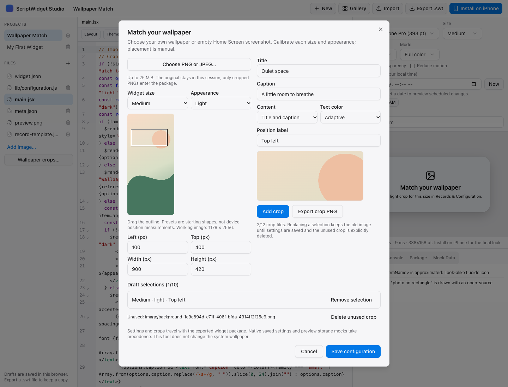

# Wallpaper Match

This template and native crop wizard prepare background images for a specific widget size, position and light/dark appearance. They match a region from your own wallpaper or an empty Home Screen screenshot. They do not set the system wallpaper or automatically determine where WidgetKit placed a widget.

## Prepare a crop

1. Install **Wallpaper Match** and open **Records & Configuration**.
2. Choose an image with Photos Picker or import a file. For a Home Screen match, use an empty page with the same wallpaper, orientation, icon layout and appearance as the intended widget position.
3. Choose the widget size and Light or Dark. The starting outline is a shape guide; drag it and adjust Left, Top, Width and Height in working-image pixels until it covers the intended area. Size presets are not device-specific placement measurements.
4. Give the position a label. Inspect the crop preview, then **Add Crop**. Alternatively, **Export Crop PNG** saves just the prepared image to a location you choose.
5. Save Configuration. Install the widget at that same position. If the match is offset, import the reference again and adjust its crop. Moving the widget, rotating the device or changing wallpaper/layout can require a new crop.

Each size has separate Light and Dark selections, for up to ten selections across five Home Screen families. A new crop for the same size/appearance replaces its draft selection. The old image remains until you save the new configuration and explicitly delete the unused crop. This preserves saved references while you review a draft. Keep at most twelve cropped files.

Only matching size/appearance assets are used: a missing dark selection does not silently pretend that the light crop matches. Accessory widgets use text/date content and do not apply a Home Screen screenshot behind their content.

## Content and appearances

Choose background only, title/caption, or calendar date. This is not a live clock. Date content uses bounded midnight timeline entries; WidgetKit controls actual refresh. Small widgets shorten long text to fit. Text color can follow the widget's appearance or use an explicit light/dark choice; inspect contrast against your own image.

Apple controls widget backgrounds and system appearances. Tinted, clear, StandBy or other system contexts can change how the image looks, even with the image's full-color preference. See Apple's [background guidance](https://developer.apple.com/documentation/widgetkit/displaying-the-right-widget-background) and [additional contexts and appearances](https://developer.apple.com/documentation/widgetkit/preparing-widgets-for-additional-contexts-and-appearances). A screenshot match is not a guarantee of true transparency.

## Files and recovery

Input files are bounded to 25 MiB, 20,000 pixels per dimension and 100 million source pixels. Orientation is normalized into a working image with a maximum edge of 3072 pixels. Crops are limited to 1024 pixels on their longest edge, normalized to sRGB and re-encoded as PNG. Original EXIF/GPS data and filenames are not copied. The whole input screenshot is kept only in the import/crop session; the package receives the crop, not the full original. Original Photos/Files items are kept.

Configuration backups preserve titles, content choices and resource references. Export the widget package separately to preserve its PNG files. A missing selected image shows **Restore this crop**, rather than invented image data. `$file.exists` checks presence; damaged image bytes still require replacing the file.

Imports and exports stay user initiated. Package paths are bounded and generated resource names cannot refer outside the current installation. An import draft cannot write into a removed, reinstalled or switched widget library. The wizard uses no network, photo-library-wide query or system wallpaper permission.

## Web Studio

Create a fresh **Wallpaper Match** copy from Gallery, then choose **Wallpaper crops…** in the file sidebar. Choose a PNG/JPEG reference, drag the rectangle and adjust the exact pixel fields. Select the size, Light/Dark appearance and a position label, then **Add crop**. Add separate selections for other sizes/appearances, choose content and text color, and **Save configuration**. The component preview updates using the saved crop; export the `.swt` package to carry the settings and images to the native app. **Export crop PNG** saves just the current selection.



PNG/JPEG import has the same source, working-image and crop limits as the native wizard. Convert unsupported browser formats before importing. The browser checks encoded dimensions before decoding and normalizes orientation. The original reference stays in memory and is discarded when the tool closes. Only prepared PNGs enter the project. Changes remain a draft until Save configuration; Cancel discards them. A late decode after closing cannot change another project, and saving is rejected if the project files changed while the tool was open.

Replacing a size/appearance keeps the earlier crop file. Save, reopen the tool and explicitly delete unused crops to reclaim the twelve-file budget. Files referenced by the original saved configuration remain protected while replacement selections are still a draft. The tool does not infer a missing dark crop from a light selection. Native saved settings and preview mock storage take precedence over the package defaults, so an existing `recordTemplate.config.v1` mock can intentionally override this preview.

Template 1.1.0 requires Runtime 1.4 or later so native Records & Configuration also understands portable defaults. Older template copies can export a PNG here but must be recreated from the current Gallery template to save portable settings. The tool does not rewrite their JavaScript automatically.

## Portable configuration

`wallpaper.json` is optional package data, with a maximum of 4096 UTF-8 bytes:

```json
{"version":1,"kind":"wallpaper","values":{"title":"My space","caption":"","content":"none","ink":"adaptive","backgrounds":[]}}
```

Its closed envelope and values use the native wallpaper configuration validation: title up to 40 UTF-16 code units, caption up to 80, content `none`/`text`/`date`, ink `adaptive`/`light`/`dark`, at most ten unique family/appearance selections. Each selection contains exactly `family`, `appearance`, `image` and `label`. Image is a generated lowercase `background-<UUID>` basename for `image/<basename>.png`; the position label is nonempty, at most 30 UTF-16 code units and contains no control/format characters. Paths and remote URLs are not accepted as image names.

The template and native configuration UI read saved `recordTemplate.config.v1` first. If it is empty/absent, they use `wallpaper.json`; a missing portable file uses the ordinary template defaults. Present invalid JSON, unknown fields, unsupported versions and invalid values report an error. A valid saved native configuration remains authoritative even when the package defaults are damaged. Reading portable defaults never seeds user storage. To preserve their references in a separate record backup, explicitly Save Configuration in the native app first; the package export already carries both defaults and PNGs.

Run `node --test Web/studio/test/wallpaperCrop.test.ts Web/studio/test/wallpaperConfiguration.test.ts` for geometry and portable export boundaries. `node Web/studio/scripts/wallpaper-crop-smoke.ts` checks actual browser codecs, pixels and metadata; after building Web Studio, `node Web/studio/scripts/wallpaper-smoke.ts` checks the Gallery-to-crop-to-package workflow, saved reload, cleanup, phone width and late/cross-snapshot writes. Both browser checks run in release-readiness when Chrome is available. Native tests cover package defaults in Records & Configuration and the real JavaScriptCore `$file` bridge, saved-setting precedence and invalid data.
