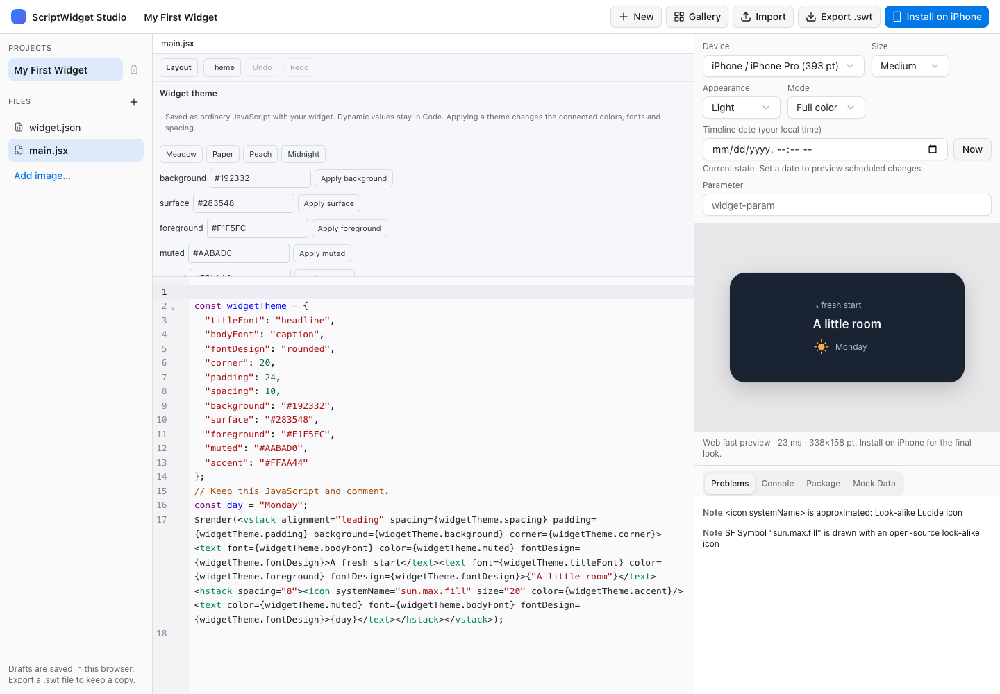

# Widget themes

Open **Theme** above the editor on iOS, macOS or Web Studio. Start with **Layout Starter**, then choose **Connect layout to Meadow theme**. This explicit operation connects the literal root background, corner and padding; supported stack spacing; and literal text/icon styling. Font design is connected on each text element, where the native runtime applies it. Existing dynamic properties remain unchanged. Opening the panel alone never changes source.

Choose Meadow, Paper, Peach or Midnight, or edit individual tokens. Changes use the existing save/preview pipeline and each operation is one Undo step. Theme JSON in the panel can be copied into another widget's Theme panel and imported. The widget itself exports as an ordinary Package 2.0 archive containing JavaScript and its resources.

## Source convention

There is no new runtime API, permission or package manifest key. The editor recognizes one top-level literal `const widgetTheme` declaration:

```jsx
const widgetTheme = {
  background: "#F2FAF5",
  surface: "#FFFFFF",
  foreground: "#193F31",
  muted: "#607C70",
  accent: "#328963",
  titleFont: "headline",
  bodyFont: "caption",
  fontDesign: "rounded",
  corner: 20,
  padding: 16,
  spacing: 10
};
$render(
  <vstack background={widgetTheme.background} padding={widgetTheme.padding}
    spacing={widgetTheme.spacing} corner={widgetTheme.corner}>
    <text font={widgetTheme.titleFont} color={widgetTheme.foreground} fontDesign={widgetTheme.fontDesign}>Hello</text>
    <text font={widgetTheme.bodyFont} color={widgetTheme.muted} fontDesign={widgetTheme.fontDesign}>Make it yours.</text>
  </vstack>
);
```

All eleven tokens must be present. Colors are six or eight digit hex strings. Fonts and font design use the existing editor/native enum values. Corner and padding range from 0–48; spacing from 0–32. The surface token is available for manually connected nested cards; initialization does not replace every nested background. Only connected properties change when a preset is applied. New layers added with Layout remain literal until connected in Code.

The Theme panel changes declaration value ranges without regenerating the file. Layout shows the resulting token references as dynamic values; edit those values in Theme. Declaration comments, unrelated logic, text, imports and resources stay intact. Directives such as `"use strict"` retain their position before the initialized declaration.

Computed values, spreads, getters, missing/extra/duplicate tokens, mutable or aliased theme references, shadowing bindings, escaped identifiers and unsupported syntax disable Theme editing and preserve Code. Literal token reads use `widgetTheme.accent`, rather than computed access. Automatic initialization requires one direct top-level JSX render and no existing widgetTheme binding/reference. This is a deliberately supported source convention, not a proof of arbitrary JavaScript behavior. Read-only documents and stale edits cannot write through the panel.

## Reusable JSON

Theme JSON version 1 contains exactly `formatVersion`, `name` and `tokens`; tokens use the eleven fields above. The name is nonempty, at most 64 UTF-8 bytes and has no control characters. Input is limited to 4 KiB. Unknown keys, unsupported versions or invalid values are rejected before changing source. JSON contains presentation values only and does not load scripts or remote resources.

The shared Theme controls and browser preview after a Midnight preset and accent/padding edits:



The shared [Assets panel](studio-assets.md) inserts package images and original theme-aware shapes. Additional visual effects and final delivery checks remain tracked in the [capabilities plan](widget-capabilities-plan.md).
